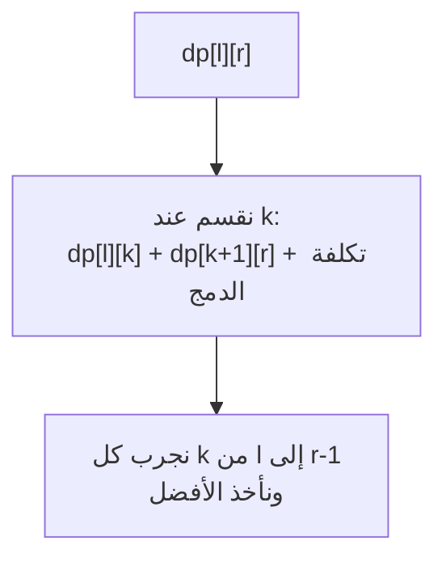

# DP على المدى (Range DP)

بعض المسائل عن **جزء متصل** [l, r] من مصفوفة، والحل الأفضل للجزء يُبنى من حلول أجزاء أصغر داخله. الحالة: `dp[l][r]` = أفضل إجابة للجزء من l إلى r.

## الفكرة العامة



**ترتيب الملء**: حسب **طول** الجزء من الأقصر للأطول، لأن كل جزء يعتمد على أجزاء أقصر منه.

## مثال: دمج الأكوام (Merging Slimes)

n كومة على خط، دمج كومتين متجاورتين يكلف مجموع حجميهما. أقل تكلفة لدمج الكل في كومة واحدة؟

- الحالة: `dp[l][r]` = أقل تكلفة لدمج الأكوام من l إلى r في كومة واحدة.
- الانتقال: آخر عملية دمج تجمع [l, k] و [k+1, r]، وتكلف مجموع الجزء كله:
  `dp[l][r] = min over k of dp[l][k] + dp[k+1][r] + sum(l, r)`
- الأساس: `dp[i][i] = 0`.

```cpp
int n; cin >> n;
vector<long long> a(n), pre(n + 1, 0);
for (int i = 0; i < n; i++) { cin >> a[i]; pre[i + 1] = pre[i] + a[i]; }
auto sum = [&](int l, int r) { return pre[r + 1] - pre[l]; };

vector<vector<long long>> dp(n, vector<long long>(n, 0));
for (int len = 2; len <= n; len++)
    for (int l = 0; l + len - 1 < n; l++) {
        int r = l + len - 1;
        dp[l][r] = LLONG_MAX;
        for (int k = l; k < r; k++)
            dp[l][r] = min(dp[l][r], dp[l][k] + dp[k + 1][r] + sum(l, r));
    }
cout << dp[0][n - 1] << "\n";
```

التعقيد O(n³): مناسب حتى n ≈ 400 إلى 500.

## مثال: أقل عمليات لجعل نص palindrome

`dp[l][r]` = أقل عدد حروف نضيفها لجعل s[l..r] palindrome:

```cpp
// dp[l][r] = 0 إذا l >= r
for (int len = 2; len <= n; len++)
    for (int l = 0; l + len - 1 < n; l++) {
        int r = l + len - 1;
        if (s[l] == s[r]) dp[l][r] = (len == 2) ? 0 : dp[l + 1][r - 1];
        else dp[l][r] = 1 + min(dp[l + 1][r], dp[l][r - 1]);
    }
```

## مثال: لعبة الطرفين (Deque game)

لاعبان يأخذان بالتناوب عنصرًا من **أحد طرفي** المصفوفة. كل منهما يلعب بأفضل طريقة. ما أكبر فرق (نقاط الأول − نقاط الثاني)؟

`dp[l][r]` = أكبر فرق يحققه **اللاعب الذي عليه الدور** على الجزء [l, r]:

```cpp
for (int i = 0; i < n; i++) dp[i][i] = a[i];
for (int len = 2; len <= n; len++)
    for (int l = 0; l + len - 1 < n; l++) {
        int r = l + len - 1;
        dp[l][r] = max(a[l] - dp[l + 1][r], a[r] - dp[l][r - 1]);
    }
```

لاحظ الطرح: بعد أن آخذ، يصبح الدور على خصمي، وأفضل فرق له يُحسب ضدي. هذه الفكرة ستعود في درس نظرية الألعاب.

## علامات Range DP

- "دمج عناصر متجاورة"، "حذف من الطرفين"، "تقسيم نص أو مصفوفة إلى أجزاء".
- n صغير نسبيًا (حتى 500) مما يسمح بـ O(n³)، أو حتى 5000 مع O(n²).

## تدرّب

AtCoder DP Contest: L (Deque) و N (Slimes). و CSES: Removal Game.

## فيديوهات اختيارية

الدرس أعلاه كامل وحده ويعمل بدون إنترنت. هذه جلسة ICPC Mansoura Community الأصلية لنفس الموضوع، إن أردت التعمّق بالمشاهدة (الجلسات طويلة، شاهدها على أجزاء).

**معسكر 1: DP على المدى (DP Ranges)**

https://www.youtube.com/watch?v=ScrEc5-dypw
