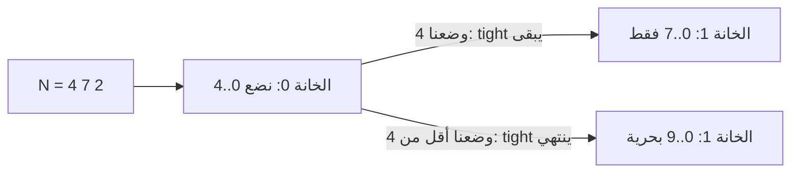

# Digit DP، ومعها Binary Search

## المسألة النموذجية

"كم عددًا صحيحًا من 0 إلى N (و N حتى 10¹⁸) مجموع أرقامه يقبل القسمة على D؟"

لا نستطيع المرور على 10¹⁸ رقمًا. لكننا نستطيع **بناء الرقم خانة خانة** من اليسار، وتذكّر ما يكفي فقط.

## الـ state

نمرّ على خانات N من الأكبر للأصغر، ونتذكر:
- `pos`: الخانة الحالية.
- `tight`: هل كل ما وضعناه حتى الآن **يساوي** بداية N؟ إذا نعم، لا نستطيع وضع رقم أكبر من خانة N الحالية. إذا لا، فقد أصبحنا أصغر من N ويمكن وضع أي رقم من 0 إلى 9.
- المعلومة الخاصة بالمسألة: هنا `sum mod D`.



## الكود

```cpp
string num;          // N كنص
int D;
long long memo[20][2][100];
bool seen[20][2][100];

long long go(int pos, bool tight, int sum) {
    if (pos == (int)num.size()) return sum == 0 ? 1 : 0;
    if (seen[pos][tight][sum]) return memo[pos][tight][sum];
    seen[pos][tight][sum] = true;
    int limit = tight ? num[pos] - '0' : 9;
    long long res = 0;
    for (int d = 0; d <= limit; d++)
        res += go(pos + 1, tight && d == limit, (sum + d) % D);
    return memo[pos][tight][sum] = res;
}

long long countUpTo(long long N) {          // من 0 إلى N
    if (N < 0) return 0;
    num = to_string(N);
    memset(seen, 0, sizeof seen);
    return go(0, true, 0);
}
// الإجابة في المدى [A, B]:  countUpTo(B) - countUpTo(A - 1)
```

عدد الحالات: 19 × 2 × D، وكل حالة تجرب 10 أرقام. سريع جدًا.

### لماذا نصفّر `seen` لكل N؟

لأن الحالات التي فيها `tight = true` تعتمد على خانات N نفسها. (يمكن حفظ حالات `tight = false` فقط بين الاستدعاءات لمزيد من السرعة، لكن التصفير أبسط وأأمن.)

## الأصفار البادئة

إذا كانت الخاصية تتأثر بالأصفار في البداية (مثل "لا يوجد رقمان متجاوران متساويان"، حيث 007 ليس رقمًا حقيقيًا)، أضف للحالة `started`: هل بدأنا الرقم فعلًا؟ ما دام `started = false` فالأصفار لا تُحسب.

## مع Binary Search: "الرقم رقم k"

"ما أصغر X بحيث يوجد **k** أرقام على الأقل من 1 إلى X تحقق الخاصية؟" الدالة `countUpTo(X)` **غير متناقصة** في X، إذن نبحث ثنائيًا على X ونستخدم Digit DP كدالة تحقق:

```cpp
long long lo = 1, hi = 2e18, ans = -1;
while (lo <= hi) {
    long long mid = lo + (hi - lo) / 2;
    if (countUpTo(mid) - countUpTo(0) >= k) { ans = mid; hi = mid - 1; }
    else lo = mid + 1;
}
```

(`countUpTo(0)` يطرح الصفر نفسه إن كان يحقق الخاصية.) التعقيد: log(2 × 10¹⁸) ≈ 61 استدعاء لـ Digit DP. هذا موضوع جلسة "Binary Search with DP on Digits" في المعسكر.

## علامات Digit DP

- مدى ضخم [A, B] حتى 10¹⁸.
- خاصية تعتمد على **أرقام** العدد (مجموعها، تكرارها، ترتيبها).

## تدرّب

AtCoder DP Contest: S (Digit Sum). و CSES: Counting Numbers.

## فيديوهات اختيارية

الدرس أعلاه كامل وحده ويعمل بدون إنترنت. هذه جلسة ICPC Mansoura Community الأصلية لنفس الموضوع، إن أردت التعمّق بالمشاهدة (الجلسات طويلة، شاهدها على أجزاء).

**معسكر 1: Bitmask DP و Digit DP (الجزء الخاص بالأرقام)**

https://www.youtube.com/watch?v=rAsQ1_P7BCw

**معسكر 1: Binary Search مع Digit DP**

https://www.youtube.com/watch?v=8xPxy6aQHRY
