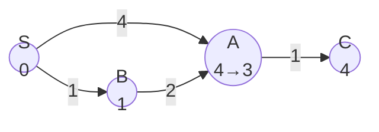

# أقصر مسار: خوارزمية Dijkstra

BFS يجد أقصر مسار عندما تكون كل الحواف **بنفس التكلفة**. عندما يكون لكل حافة وزن مختلف (مسافات، أزمنة، تكاليف) **غير سالب**، نستخدم **Dijkstra**.

## الفكرة

في كل خطوة، خذ العقدة **الأقرب** للمصدر التي لم تثبت مسافتها بعد، ثبّت مسافتها، وحسّن مسافات جيرانها. لأن الأوزان غير سالبة، لا يمكن لمسار أطول أن يعود ويصبح أقصر.



أولًا نثبت B (المسافة 1)، ومنها تتحسن A من 4 إلى 3، ثم نثبت A، ثم C = 4.

## الكود (مع priority_queue)

```cpp
int n, m;
cin >> n >> m;
vector<vector<pair<int,long long>>> g(n + 1);     // {الجار، الوزن}
for (int i = 0; i < m; i++) {
    int u, v; long long w;
    cin >> u >> v >> w;
    g[u].push_back({v, w});
    g[v].push_back({u, w});                        // احذفه إن كان الجراف موجّهًا
}

const long long INF = LLONG_MAX / 4;
vector<long long> dist(n + 1, INF);
priority_queue<pair<long long,int>, vector<pair<long long,int>>, greater<>> pq;  // الأصغر أولًا
dist[1] = 0;
pq.push({0, 1});
while (!pq.empty()) {
    auto [d, u] = pq.top(); pq.pop();
    if (d != dist[u]) continue;            // نسخة قديمة في الطابور: تجاهلها
    for (auto [v, w] : g[u])
        if (dist[u] + w < dist[v]) {
            dist[v] = dist[u] + w;
            pq.push({dist[v], v});
        }
}
```

التعقيد O((n + m) log m).

**السطر الأهم**: `if (d != dist[u]) continue;`. قد ندفع نفس العقدة للطابور أكثر من مرة بمسافات مختلفة؛ هذا السطر يتجاهل النسخ القديمة. بدونه يصبح الحل بطيئًا جدًا في بعض الاختبارات.

## استرجاع المسار

احفظ `par[v] = u` عند كل تحسين، ثم ارجع من الهدف للمصدر واعكس (مثل BFS).

## تنويعات مشهورة

- **عدة مصادر**: ادفع كل المصادر بمسافة 0 في البداية.
- **حالة إضافية**: "أقصر مسار مع استخدام كوبون خصم مرة واحدة": اجعل العقدة (u, هل استخدمنا الكوبون) أي 2n عقدة.
- **0-1 BFS**: إذا كانت الأوزان 0 أو 1 فقط، استخدم `deque`: الحافة بوزن 0 تُضاف في **المقدمة** وبوزن 1 في **النهاية**: O(n + m).

## متى لا يعمل؟

مع **أوزان سالبة** يعطي Dijkstra نتائج خاطئة. استخدم **Bellman–Ford** (O(n × m)) الذي يكتشف أيضًا الدوائر السالبة. ولأقصر مسار بين **كل** الأزواج مع n صغير (≤ 500): **Floyd–Warshall** في O(n³):

```cpp
// d[i][j] = الوزن المباشر أو INF، و d[i][i] = 0
for (int k = 0; k < n; k++)
    for (int i = 0; i < n; i++)
        for (int j = 0; j < n; j++)
            if (d[i][k] < INF && d[k][j] < INF)
                d[i][j] = min(d[i][j], d[i][k] + d[k][j]);
```

## تدرّب

CSES قسم Graph Algorithms: Shortest Routes I و II، Flight Discount، Flight Routes.

## فيديوهات اختيارية

الدرس أعلاه كامل وحده ويعمل بدون إنترنت. هذه جلسة ICPC Mansoura Community الأصلية لنفس الموضوع، إن أردت التعمّق بالمشاهدة (الجلسات طويلة، شاهدها على أجزاء).

**معسكر 2: الجراف، Dijkstra**

https://www.youtube.com/watch?v=qH8DusU744o
