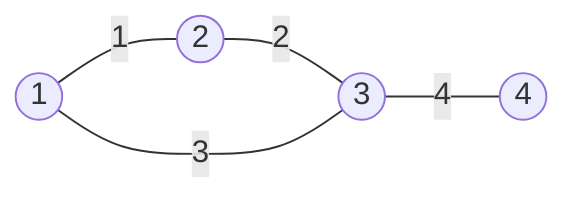

# DSU و Minimum Spanning Tree (MST) (MST)

## DSU: اتحاد المجموعات المنفصلة

**DSU** (Disjoint Set Union، ويسمى Union-Find) يحفظ عناصر مقسمة إلى مجموعات، ويجيب بسرعة شبه ثابتة:
- `find(x)`: ما ممثل (رئيس) مجموعة x؟
- `unite(a, b)`: ادمج مجموعتي a و b.

كل مجموعة tree، والممثل جذرها. تحسينان يجعلانه سريعًا جدًا:
- **ضغط المسار**: عند البحث عن الـ root، اربط كل node مررنا بها بالـ root مباشرة.
- **الدمج حسب الحجم**: علّق الـ tree الأصغر تحت الأكبر.

```cpp
struct DSU {
    vector<int> parent, sz;
    DSU(int n) : parent(n), sz(n, 1) { iota(parent.begin(), parent.end(), 0); }
    int find(int x) {
        while (x != parent[x]) {
            parent[x] = parent[parent[x]];     // ضغط المسار (نصف خطوة، بدون Recursion)
            x = parent[x];
        }
        return x;
    }
    bool unite(int a, int b) {
        a = find(a); b = find(b);
        if (a == b) return false;              // في نفس المجموعة بالفعل
        if (sz[a] < sz[b]) swap(a, b);
        parent[b] = a;
        sz[a] += sz[b];
        return true;
    }
};
```

كل عملية تقريبًا O(1) (رسميًا O(α(n))، و α أقل من 5 لأي n عملي).

### استخدامات

- عدد الـ Connected Components **أثناء إضافة الـ edges** (يبدأ n ويقل 1 مع كل `unite` ناجح).
- هل إضافة edge تصنع cycle؟ (إذا كان طرفاها في نفس المجموعة).
- حجم أكبر مكوّن بعد كل إضافة.

## Minimum Spanning Tree (MST) (MST)

لدينا graph موزون متصل. نريد اختيار edges تربط **كل** الـ nodes بأقل مجموع أوزان. الناتج tree فيها n − 1 edge. تطبيقات: أقل تكلفة لربط مدن بطرق، أو بيوت بكابلات.

### خوارزمية Kruskal

1. رتّب الـ edges حسب الوزن تصاعديًا.
2. لكل edge بالترتيب: إذا كان طرفاها في مجموعتين مختلفتين، خذها وادمج المجموعتين. وإلا تجاهلها (ستصنع cycle).

```cpp
int n, m;
cin >> n >> m;
vector<array<long long,3>> edges(m);          // {w, u, v}
for (auto &[w, u, v] : edges) cin >> u >> v >> w;
sort(edges.begin(), edges.end());

DSU dsu(n + 1);
long long total = 0;
int used = 0;
for (auto &[w, u, v] : edges)
    if (dsu.unite(u, v)) { total += w; used++; }

if (used != n - 1) cout << "IMPOSSIBLE\n";    // الـ graph غير متصل
else cout << total << "\n";
```

التعقيد O(m log m) بسبب الترتيب.



بالترتيب: نأخذ 1 (يربط 1 و 2)، ثم 2 (يربط 3)، ونتجاهل 3 (1 و 3 متصلان بالفعل)، ثم نأخذ 4. المجموع 7.

**لماذا صحيح؟** هي Greedy Algorithm: أخف edge تعبر بين أي جزأين من الـ nodes آمنة دائمًا (خاصية القطع: cut property).

## Prim (بديل)

يبني الـ tree من node واحدة، ويضيف كل مرة أخف edge تخرج من الـ tree الحالية (بـ priority_queue، مثل Dijkstra). Kruskal مع DSU أبسط كتابة غالبًا.

## تدرّب

CSES: Road Reparation (MST)، Road Construction (DSU: عدد المكوّنات وأكبرها)، Building Roads.

## فيديوهات اختيارية

الدرس أعلاه كامل وحده ويعمل بدون إنترنت. هذه جلسة ICPC Mansoura Community الأصلية لنفس الموضوع، إن أردت التعمّق بالمشاهدة (الجلسات طويلة، شاهدها على أجزاء).

**معسكر 2: الـ graph، DSU و MST**

https://www.youtube.com/watch?v=PN917m2-64M
