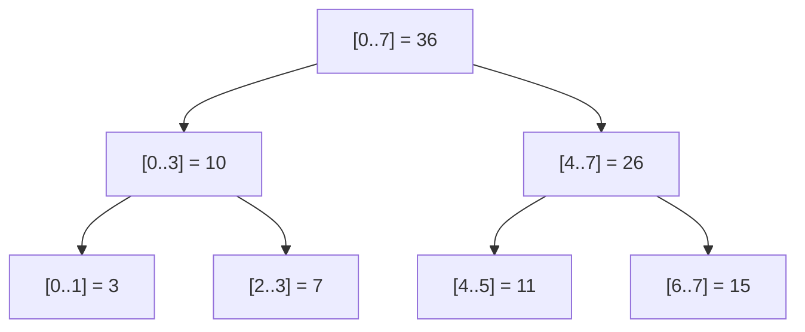

# شجرة المقاطع (Segment Tree)

## المشكلة

مصفوفة فيها n عنصر، و q عملية من نوعين:
1. غيّر قيمة a[i].
2. ما مجموع (أو أصغر قيمة في) الجزء من l إلى r؟

المجموع التراكمي يجيب النوع 2 في O(1) لكن كل تعديل يكلف O(n). المرور المباشر عكس ذلك. مع n و q حتى 2 × 10⁵ نحتاج **كليهما سريعًا**: O(log n).

## الفكرة

شجرة كل عقدة فيها تخزن إجابة **جزء** من المصفوفة. الجذر للمصفوفة كلها، وكل عقدة تنقسم لنصفين:



- **سؤال** عن أي جزء = تجميع O(log n) عقدة.
- **تعديل** عنصر = تحديث العقد على مسار واحد من الورقة للجذر: O(log n).

## الكود (تكراري، مختصر وسريع)

```cpp
struct SegTree {
    int n;
    vector<long long> t;
    SegTree(int n) : n(n), t(2 * n, 0) {}
    void build(const vector<long long> &a) {
        for (int i = 0; i < n; i++) t[n + i] = a[i];
        for (int i = n - 1; i > 0; i--) t[i] = t[2 * i] + t[2 * i + 1];
    }
    void update(int pos, long long value) {         // a[pos] = value
        for (t[pos += n] = value; pos > 1; pos >>= 1)
            t[pos >> 1] = t[pos] + t[pos ^ 1];
    }
    long long query(int l, int r) {                 // مجموع [l, r]، شامل الطرفين
        long long res = 0;
        for (l += n, r += n + 1; l < r; l >>= 1, r >>= 1) {
            if (l & 1) res += t[l++];
            if (r & 1) res += t[--r];
        }
        return res;
    }
};
```

الاستخدام:

```cpp
SegTree st(n);
st.build(a);
st.update(3, 10);                   // a[3] = 10
cout << st.query(1, 5) << "\n";     // مجموع a[1..5]
```

## عمليات أخرى

غيّر عملية الدمج وقيمة "المحايد" (identity):

| السؤال | الدمج | المحايد |
|---|---|---|
| المجموع | `a + b` | 0 |
| أصغر قيمة | `min(a, b)` | `LLONG_MAX` |
| أكبر قيمة | `max(a, b)` | `LLONG_MIN` |
| GCD | `gcd(a, b)` | 0 |
| XOR | `a ^ b` | 0 |

مثلًا لأصغر قيمة: في `build` و `update` استخدم `min`، وفي `query` ابدأ `res` بـ `LLONG_MAX` واستخدم `res = min(res, t[...])`.

**شرط**: العملية يجب أن تكون **تجميعية** (associative): (a ∘ b) ∘ c = a ∘ (b ∘ c).

## الشكل الذاتي الاستدعاء (لما بعد ذلك)

الشكل التكراري أعلاه ممتاز للتعديل على عنصر والسؤال عن جزء. لعمليات أعقد (مثل "أضف x لكل عناصر الجزء" مع أسئلة على أجزاء)، نحتاج الشكل **الذاتي الاستدعاء** مع **Lazy Propagation**: تأجيل التعديلات في العقد العليا حتى نحتاجها. هذا من موضوعات ما بعد هذا الكورس.

## البديل الأبسط: Fenwick Tree (BIT)

إذا احتجت **المجموع** فقط مع تعديلات، شجرة Fenwick أقصر كتابة:

```cpp
struct BIT {
    int n; vector<long long> f;
    BIT(int n) : n(n), f(n + 1, 0) {}
    void add(int i, long long v) { for (i++; i <= n; i += i & -i) f[i] += v; }
    long long sum(int i) { long long s = 0; for (i++; i > 0; i -= i & -i) s += f[i]; return s; }   // a[0..i]
    long long sum(int l, int r) { return sum(r) - (l ? sum(l - 1) : 0); }
};
```

لاحظ أن `add` **تضيف** للعنصر (لا تستبدله). لتعيين a[i] = v: `add(i, v - a[i])` ثم حدّث a[i].

## تدرّب

CSES قسم Range Queries: Dynamic Range Sum Queries، Dynamic Range Minimum Queries، Range Xor Queries، Hotel Queries.

## فيديوهات اختيارية

الدرس أعلاه كامل وحده ويعمل بدون إنترنت. هذه جلسة ICPC Mansoura Community الأصلية لنفس الموضوع، إن أردت التعمّق بالمشاهدة (الجلسات طويلة، شاهدها على أجزاء).

**معسكر 3: شجرة المقاطع (Segment Tree)**

https://www.youtube.com/watch?v=d1haTFvOiCw
