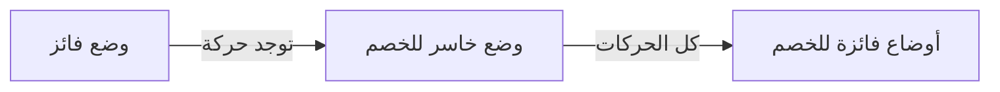

# نظرية الألعاب (Game Theory)

مسائل نظرية الألعاب: لاعبان يلعبان بالتناوب، **كلاهما يلعب بأفضل طريقة**، ولا حظ في اللعبة. من يفوز؟

## حالات الفوز والخسارة

كل وضع في اللعبة إما:
- **وضع خاسر (L)**: كل حركة منه تؤدي إلى وضع فائز للخصم (أو لا حركات أصلًا، في القاعدة المعتادة "من لا يستطيع اللعب يخسر").
- **وضع فائز (W)**: توجد **حركة واحدة على الأقل** تؤدي لوضع خاسر للخصم.



## مثال: لعبة الأحجار

كومة فيها n حجر، كل دور تأخذ 1 أو 3 أو 4 أحجار. من لا يستطيع الأخذ يخسر. هل يفوز الأول؟

```cpp
vector<bool> win(n + 1, false);          // win[0] = false: لا حركات
int moves[] = {1, 3, 4};
for (int i = 1; i <= n; i++)
    for (int mv : moves)
        if (mv <= i && !win[i - mv]) { win[i] = true; break; }
cout << (win[n] ? "First" : "Second") << "\n";
```

هذا **DP على الأوضاع**. وكثيرًا ما يظهر **نمط دوري** (هنا الخاسرة: n mod 7 = 0 أو 2)؛ اطبع أول 30 قيمة وابحث عن النمط إن كانت n ضخمة.

## لعبة Nim

عدة أكوام بأحجام a₁, a₂, ..., aₖ. كل دور تأخذ أي عدد (≥ 1) من **كومة واحدة**. من يأخذ آخر حجر يفوز.

**النظرية**: الأول يفوز إذا وفقط إذا كان **XOR** كل الأحجام ≠ 0.

```cpp
long long x = 0;
for (long long v : piles) x ^= v;
cout << (x != 0 ? "First" : "Second") << "\n";
```

لماذا؟ من وضع XOR = 0، أي حركة تجعله ≠ 0. ومن وضع XOR ≠ 0 توجد دائمًا حركة تعيده 0. والوضع النهائي (كل الأكوام فارغة) XOR = 0 وهو خاسر لمن عليه الدور.

## أعداد Grundy (Sprague–Grundy)

لعبة مكونة من **عدة ألعاب مستقلة** (تلعب في واحدة منها كل دور). لكل وضع رقم Grundy:

- grundy(وضع لا حركات منه) = 0.
- grundy(x) = **mex** لأرقام Grundy للأوضاع التي يمكن الوصول إليها. (mex = أصغر عدد صحيح غير سالب **غير موجود** في المجموعة.)

**النظرية**: اللعبة المجمعة فائزة للأول إذا وفقط إذا كان XOR أرقام Grundy للألعاب ≠ 0. (Nim حالة خاصة: grundy لكومة حجمها a هو a.)

```cpp
// كومة، والحركة: خذ 1 أو 3 أو 4
vector<int> g(MAXV + 1, 0);
for (int i = 1; i <= MAXV; i++) {
    set<int> reach;
    for (int mv : {1, 3, 4}) if (mv <= i) reach.insert(g[i - mv]);
    int mex = 0;
    while (reach.count(mex)) mex++;
    g[i] = mex;
}
// عدة أكوام: XOR قيم g لأحجامها
int x = 0;
for (int v : piles) x ^= g[v];
cout << (x ? "First" : "Second") << "\n";
```

## ألعاب على المصفوفة: تذكير

لعبة "خذ من أحد الطرفين" (درس Range DP) ليست لعبة فوز/خسارة بل **فرق نقاط**، وحلها `dp[l][r]` = أفضل فرق لمن عليه الدور. نفس روح نظرية الألعاب: افترض أن الخصم يلعب بأفضل طريقة.

## طريقة عملية لأي مسألة ألعاب

1. اكتب حلًا بطيئًا (DP على كل الأوضاع) للقيم الصغيرة.
2. اطبع جدول W/L أو أرقام Grundy لأول 50 وضع.
3. ابحث عن نمط (دورية، زوجية، علاقة بالـ XOR)، وأثبته أو اختبره على قيم أكبر.

## تدرّب

AtCoder DP Contest: K (Stones). و CSES قسم Mathematics: Nim Game I و II، Stair Game، Grundy's Game.

## فيديوهات اختيارية

الدرس أعلاه كامل وحده ويعمل بدون إنترنت. هذه جلسة ICPC Mansoura Community الأصلية لنفس الموضوع، إن أردت التعمّق بالمشاهدة (الجلسات طويلة، شاهدها على أجزاء).

**معسكر 4: نظرية الألعاب (Game Theory)**

https://www.youtube.com/watch?v=ediW8zR4dEY
