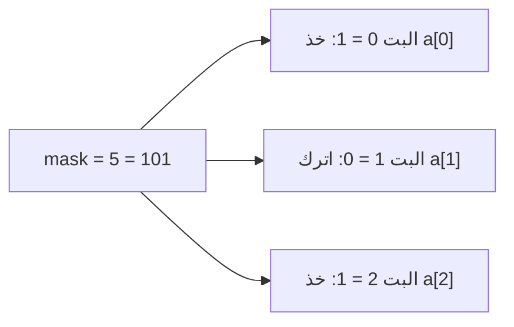

# Bitmasks و Complete Search

## العمليات على Bitmasks

كل رقم مخزّن كبتات (0 و 1). 13 = `1101`.

| العملية | الرمز | مثال |
|---|---|---|
| AND | `&` | `1101 & 1011 = 1001` |
| OR | `\|` | `1101 \| 1011 = 1111` |
| XOR | `^` | `1101 ^ 1011 = 0110` |
| إزاحة لليسار | `<<` | `1 << 3 = 1000` = 8 |
| إزاحة لليمين | `>>` | `13 >> 1 = 110` = 6 |

حيل ستستخدمها دائمًا:

```cpp
(x >> i) & 1        // قيمة البت رقم i
x | (1 << i)        // اجعل البت i = 1
x & ~(1 << i)       // اجعل البت i = 0
x ^ (1 << i)        // اعكس البت i
__builtin_popcount(x)      // عدد Bitmasks = 1 (للـ long long: __builtin_popcountll)
(x & 1)             // 1 إذا كان x فرديًا
```

خصائص XOR مهمة جدًا: `a ^ a = 0`، `a ^ 0 = a`، والترتيب لا يهم. مثال: كل رقم مكرر مرتين إلا رقمًا واحدًا؛ اعمل XOR للكل، فتبقى القيمة الفريدة.

## Complete Search

أحيانًا الحل هو **تجربة كل الاحتمالات**. هذا صحيح دائمًا، والسؤال الوحيد: هل سيكون سريعًا بما يكفي؟ الـ constraints تخبرك: n ≤ 20 تقريبًا يعني أن 2ⁿ ممكنة.

### كل الـ subsets بـ Bitmasks

كل رقم من 0 إلى 2ⁿ − 1 يمثل subset: البت i = 1 يعني "أخذنا العنصر i".

```cpp
int n; cin >> n;
vector<long long> a(n);
for (auto &x : a) cin >> x;
long long target; cin >> target;

bool ok = false;
for (int mask = 0; mask < (1 << n); mask++) {
    long long sum = 0;
    for (int i = 0; i < n; i++)
        if ((mask >> i) & 1) sum += a[i];
    if (sum == target) ok = true;
}
cout << (ok ? "YES" : "NO") << "\n";
```

التعقيد O(2ⁿ × n). لـ n = 20: حوالي 2 × 10⁷: سريع.



### لفّات متداخلة بذكاء

مثال: كم ثلاثية (a, b, c) من 0 إلى n حيث a + b + c = s؟ بدلًا من ثلاث لفات O(n³)، لفّتان واحسب c = s − a − b وتحقق أنه في المدى: O(n²).

**قاعدة**: في Complete Search، قلّل عدد ما تجرّبه باستنتاج ما يمكن حسابه مباشرة.

### كل الـ permutations

```cpp
vector<int> p(n);
iota(p.begin(), p.end(), 0);   // 0, 1, ..., n-1
do {
    // جرّب الترتيب p
} while (next_permutation(p.begin(), p.end()));
```

n! تكبر بسرعة: مناسبة حتى n ≈ 10.

## تدرّب

شيت Bitmasks and Complete Search في Level 1.

## فيديوهات اختيارية

الدرس أعلاه كامل وحده ويعمل بدون إنترنت. هذه جلسة ICPC Mansoura Community الأصلية لنفس الموضوع، إن أردت التعمّق بالمشاهدة (الجلسات طويلة، شاهدها على أجزاء).

**المستوى 1، الجلسة 5: Bitmasks و Complete Search**

https://www.youtube.com/watch?v=H2yaBzB5LtM
