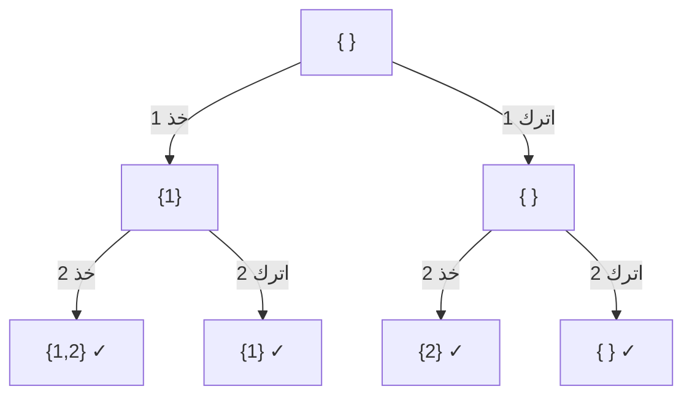

# الاستدعاء الذاتي والتراجع (Recursion & Backtracking)

## الاستدعاء الذاتي (Recursion)

دالة تحل المسألة باستدعاء نفسها على **نسخة أصغر** منها. لا بد من:
1. **حالة أساس (base case)** توقف الاستدعاء.
2. **خطوة** تقترب من حالة الأساس.

```cpp
long long fact(int n) {
    if (n == 0) return 1;          // الأساس
    return n * fact(n - 1);        // الخطوة
}
```

فكّر بثقة: افترض أن `fact(n-1)` تعمل صحيحًا، واسأل فقط: كيف أستخدم نتيجتها؟

بدون حالة أساس، أو إذا كان العمق كبيرًا جدًا (ملايين المستويات)، يحدث **Stack Overflow** (Runtime Error).

## التراجع (Backtracking)

نبني الحل خطوة بخطوة: نجرّب اختيارًا، نكمل، ثم **نتراجع عنه** ونجرّب غيره. هو البحث الكامل بشكل منظم.

### كل المجموعات الجزئية

```cpp
int n;
vector<int> a, cur;

void go(int i) {
    if (i == n) {                       // قررنا لكل العناصر
        for (int x : cur) cout << x << " ";
        cout << "\n";
        return;
    }
    cur.push_back(a[i]);   // اختيار: خذ a[i]
    go(i + 1);
    cur.pop_back();        // تراجع
    go(i + 1);             // اختيار: اترك a[i]
}
```



### كل التباديل

```cpp
vector<int> perm;
vector<bool> used;

void gen() {
    if ((int)perm.size() == n) { /* اطبع perm */ return; }
    for (int i = 1; i <= n; i++) {
        if (used[i]) continue;
        used[i] = true; perm.push_back(i);
        gen();
        used[i] = false; perm.pop_back();   // تراجع
    }
}
```

### N-Queens: مثال على التقليم

ضع n ملكة على رقعة n × n بحيث لا تهاجم ملكة أخرى. نضع ملكة في كل صف، ونتخطى أي عمود أو قطر مشغول **فورًا** بدل أن نكمل ثم نكتشف الخطأ:

```cpp
int n, ways = 0;
vector<bool> col, d1, d2;

void place(int r) {
    if (r == n) { ways++; return; }
    for (int c = 0; c < n; c++) {
        if (col[c] || d1[r + c] || d2[r - c + n - 1]) continue;   // تقليم
        col[c] = d1[r + c] = d2[r - c + n - 1] = true;
        place(r + 1);
        col[c] = d1[r + c] = d2[r - c + n - 1] = false;
    }
}
// col(n), d1(2n-1), d2(2n-1) كلها false في البداية
```

**التقليم (pruning)** هو ما يجعل التراجع سريعًا في الواقع: لا تكمل في طريق تعرف أنه لن ينجح.

## من التراجع إلى البرمجة الديناميكية

إذا استُدعيت الدالة **بنفس المدخلات مرات كثيرة**، احفظ النتيجة. هذا هو باب **البرمجة الديناميكية** (آخر درس).

## تدرّب

شيت Recursion and Backtracking في Level 1.

## فيديوهات اختيارية

الدرس أعلاه كامل وحده ويعمل بدون إنترنت. هذه جلسة ICPC Mansoura Community الأصلية لنفس الموضوع، إن أردت التعمّق بالمشاهدة (الجلسات طويلة، شاهدها على أجزاء).

**المستوى 1، الجلسة 6: Recursion و Backtracking**

https://www.youtube.com/watch?v=yWRV8RGhsCw
