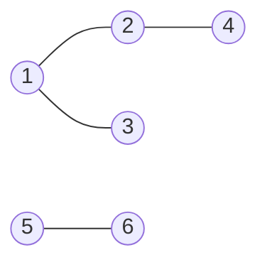

# مقدمة في الـ graph و DFS

## ما هو الـ graph؟

**الـ graph** مجموعة **nodes** تربطها **edges**: مدن وطرق، أشخاص وصداقات، صفحات وروابط، خانات شبكة متجاورة.



هذا الـ graph فيه **two connected components**: {1, 2, 3, 4} و {5, 6}.

أنواع:
- **Undirected**: الطريق في الاتجاهين. **Directed**: في اتجاه واحد.
- **Weighted**: لكل edge تكلفة (مسافة، زمن).
- **tree**: graph متصل بلا cycles، فيه n − 1 edge.

## تمثيل الـ graph: Adjacency List

```cpp
int n, m;
cin >> n >> m;
vector<vector<int>> adj(n + 1);
for (int i = 0; i < m; i++) {
    int u, v;
    cin >> u >> v;
    adj[u].push_back(v);
    adj[v].push_back(u);       // احذف هذا السطر إذا كان موجّهًا
}
```

الذاكرة O(n + m). (array n × n ممكنة فقط إذا كان n صغيرًا، حتى ~1000.)

## DFS

DFS يذهب لأعمق نقطة ممكنة ثم يرجع. array `vis` تمنع زيارة الـ node مرتين (وإلا ندور للأبد في الـ cycles).

```cpp
vector<bool> vis;

void dfs(int u) {
    vis[u] = true;
    for (int v : adj[u])
        if (!vis[v]) dfs(v);
}
```

التعقيد O(n + m): كل node وكل edge مرة واحدة.

### عدد الـ Connected Components

```cpp
vis.assign(n + 1, false);
int comps = 0;
for (int u = 1; u <= n; u++)
    if (!vis[u]) { dfs(u); comps++; }
cout << comps << "\n";
```

استخدام شهير: "أقل عدد طرق نضيفها ليصبح الـ graph متصلًا" = comps − 1.

### DFS على الشبكة (Grid)

كل خانة node، وجيرانها الأربعة (أعلى، أسفل، يمين، يسار):

```cpp
int n, m;
vector<string> g;
vector<vector<bool>> seen;
int dx[] = {1, -1, 0, 0}, dy[] = {0, 0, 1, -1};

void dfs(int x, int y) {
    seen[x][y] = true;
    for (int k = 0; k < 4; k++) {
        int nx = x + dx[k], ny = y + dy[k];
        if (nx >= 0 && ny >= 0 && nx < n && ny < m && g[nx][ny] == '.' && !seen[nx][ny])
            dfs(nx, ny);
    }
}
// عدد "الغرف": لكل خانة '.' لم تُزر، dfs منها وزِد العدّاد
```

### اكتشاف الـ cycles (Cycle Detection)

في graph غير موجّه: إذا وصل DFS لـ node مزارة **ليست أباه المباشر**، توجد cycle:

```cpp
bool hasCycle(int u, int parent) {
    vis[u] = true;
    for (int v : adj[u]) {
        if (!vis[v]) { if (hasCycle(v, u)) return true; }
        else if (v != parent) return true;
    }
    return false;
}
```

## تنبيه حول العمق

DFS بـ Recursion على graph شكله خط طويل (10⁵ node أو أكثر) قد يسبب Stack Overflow في بعض الأنظمة. على Codeforces عادة لا مشكلة، لكن يمكن كتابته بـ `stack` صريحة إذا احتجت.

## تدرّب

شيت Intro To Graph and DFS في Level 1.

## فيديوهات اختيارية

الدرس أعلاه كامل وحده ويعمل بدون إنترنت. هذه جلسة ICPC Mansoura Community الأصلية لنفس الموضوع، إن أردت التعمّق بالمشاهدة (الجلسات طويلة، شاهدها على أجزاء).

**المستوى 1، الجلسة 7: مقدمة في الـ graph و DFS**

https://www.youtube.com/watch?v=crRWp-U0UrM
