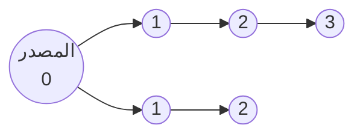

# BFS وتطبيقات الجراف

## البحث بالعرض (BFS)

BFS يزور العقد **طبقة بطبقة**: أولًا كل من يبعد خطوة، ثم كل من يبعد خطوتين، وهكذا. لذلك يجد **أقصر مسار** (بعدد الحواف) في جراف غير موزون.

```cpp
vector<int> dist(n + 1, -1);
queue<int> q;
dist[src] = 0;
q.push(src);
while (!q.empty()) {
    int u = q.front(); q.pop();
    for (int v : adj[u]) {
        if (dist[v] == -1) {          // لم يُزر
            dist[v] = dist[u] + 1;
            q.push(v);
        }
    }
}
// dist[x] = أقصر مسافة من src إلى x، أو -1 إن لم يمكن الوصول
```



علّم العقدة كمزارة **عند إضافتها للطابور**، لا عند إخراجها، وإلا تدخل الطابور مرات كثيرة.

### استرجاع المسار نفسه

احفظ "من أين جئت" لكل عقدة، ثم ارجع من الهدف:

```cpp
vector<int> par(n + 1, -1);
// داخل BFS عند اكتشاف v: par[v] = u;
vector<int> path;
for (int x = target; x != -1; x = par[x]) path.push_back(x);
reverse(path.begin(), path.end());
```

### BFS على الشبكة: أقصر طريق في متاهة

نفس فكرة DFS على الشبكة، لكن بـ `queue` ومصفوفة مسافات ثنائية الأبعاد. أشهر مسائل المسابقات.

### BFS من عدة مصادر

ضع **كل** المصادر في الطابور بمسافة 0 في البداية. مثال: كل خانة، ما بعدها عن أقرب نار؟ تنتشر النيران كلها معًا.

## DFS أم BFS؟

| السؤال | استخدم |
|---|---|
| هل يمكن الوصول؟ عدد المكوّنات؟ | أي منهما (DFS أبسط) |
| أقصر مسار في جراف غير موزون | BFS |
| أقل عدد خطوات/حركات | BFS |
| اكتشاف دوائر، ترتيب طوبولوجي | DFS (أو Kahn بـ BFS) |

## تطبيقات مهمة

### الترتيب الطوبولوجي (Topological Sort)

مهام لها شروط: "المهمة a قبل b". في جراف موجّه بلا دوائر، رتّب المهام. خوارزمية Kahn: ابدأ بكل مهمة ليس لها شروط (in-degree = 0)، وكلما نفّذت مهمة أنقص شروط من بعدها:

```cpp
vector<int> indeg(n + 1, 0), order;
for (int u = 1; u <= n; u++) for (int v : adj[u]) indeg[v]++;
queue<int> q;
for (int u = 1; u <= n; u++) if (indeg[u] == 0) q.push(u);
while (!q.empty()) {
    int u = q.front(); q.pop();
    order.push_back(u);
    for (int v : adj[u]) if (--indeg[v] == 0) q.push(v);
}
// إذا كان order.size() < n فهناك دائرة: لا يوجد ترتيب
```

### الجراف ثنائي التلوين (Bipartite)

هل يمكن تلوين العقد بلونين بحيث لا تتشابه عقدتان متجاورتان؟ لوّن بـ BFS بالتبادل؛ إذا وجدت جارين بنفس اللون فالإجابة لا.

## ما بعد Level 1

في Level 2 (معسكرات ICPC Mansoura) ستتعلم **Dijkstra** لأقصر مسار في جراف موزون، و**DSU** و**MST**.

## تدرّب

شيت BFS في Level 1.

## فيديوهات اختيارية

الدرس أعلاه كامل وحده ويعمل بدون إنترنت. هذه جلسة ICPC Mansoura Community الأصلية لنفس الموضوع، إن أردت التعمّق بالمشاهدة (الجلسات طويلة، شاهدها على أجزاء).

**المستوى 1، الجلسة 8: BFS وتطبيقات الجراف**

https://www.youtube.com/watch?v=AuGNPvbfy4A
