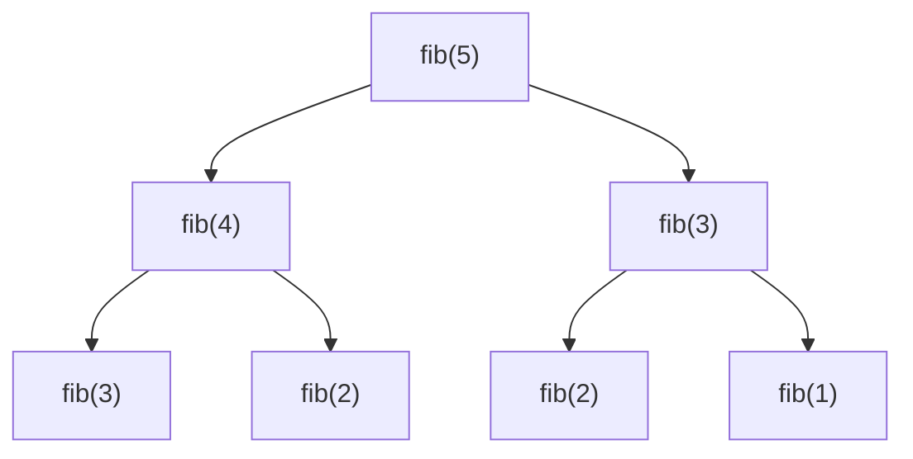

# البرمجة الديناميكية (Dynamic Programming)

**البرمجة الديناميكية (DP)** تحل المسألة بتقسيمها لمسائل أصغر **تتكرر**، وحل كل مسألة صغيرة **مرة واحدة فقط** وحفظ نتيجتها.

## لماذا؟ مثال فيبوناتشي

```cpp
long long fib(int n) {             // بطيء جدًا: O(2^n)
    if (n <= 1) return n;
    return fib(n - 1) + fib(n - 2);
}
```



`fib(3)` تُحسب مرتين، و`fib(2)` ثلاث مرات... لـ n = 50 مليارات الاستدعاءات.

## الطريقة 1: من أعلى لأسفل (Memoization)

نفس الاستدعاء الذاتي، مع **حفظ** كل نتيجة:

```cpp
vector<long long> memo(N, -1);
long long fib(int n) {
    if (n <= 1) return n;
    if (memo[n] != -1) return memo[n];       // حُسبت من قبل
    return memo[n] = fib(n - 1) + fib(n - 2);
}
```

الآن O(n). هذا ما تسميه شيت ICPC Mansoura "DP Recursive".

## الطريقة 2: من أسفل لأعلى (Tabulation)

املأ جدولًا من الحالات الصغيرة للكبيرة، بدون استدعاء ذاتي ("DP Iterative"):

```cpp
vector<long long> dp(n + 1);
dp[0] = 0; dp[1] = 1;
for (int i = 2; i <= n; i++) dp[i] = dp[i - 1] + dp[i - 2];
```

## الخطوات الأربع لأي مسألة DP

1. **الحالة (state)**: ماذا يعني `dp[i]` بالكلمات؟ اكتبها قبل الكود.
2. **الانتقال (transition)**: كيف أحسب `dp[i]` من حالات أصغر؟
3. **حالات الأساس**.
4. **الإجابة**: أي حالة فيها الإجابة النهائية؟

## مثال: الضفدع (Frog)

ضفدع على حجارة بارتفاعات h، يقفز خطوة أو خطوتين، وتكلفة القفزة |h[i] − h[j]|. أقل تكلفة للوصول للحجر الأخير؟

1. الحالة: `dp[i]` = أقل تكلفة للوصول للحجر i.
2. الانتقال: آخر قفزة كانت من i−1 أو i−2:
   `dp[i] = min(dp[i-1] + |h[i]-h[i-1]|, dp[i-2] + |h[i]-h[i-2]|)`
3. الأساس: `dp[0] = 0`.
4. الإجابة: `dp[n-1]`.

```cpp
vector<long long> dp(n, LLONG_MAX);
dp[0] = 0;
for (int i = 1; i < n; i++) {
    dp[i] = dp[i - 1] + abs(h[i] - h[i - 1]);
    if (i >= 2) dp[i] = min(dp[i], dp[i - 2] + abs(h[i] - h[i - 2]));
}
cout << dp[n - 1] << "\n";
```

## مثال: الحقيبة 0/1 (Knapsack)

n غرض، لكل غرض وزن w وقيمة v، والحقيبة تتسع لوزن W. أكبر قيمة؟ (كل غرض مرة على الأكثر)

```cpp
vector<long long> dp(W + 1, 0);              // dp[c] = أكبر قيمة بسعة c
for (int i = 0; i < n; i++)
    for (int c = W; c >= w[i]; c--)          // تنازليًا حتى لا نأخذ الغرض مرتين
        dp[c] = max(dp[c], dp[c - w[i]] + v[i]);
cout << dp[W] << "\n";
```

التعقيد O(n × W).

## مثال: أطول تتابع مشترك (LCS) لنصين

`dp[i][j]` = طول LCS لأول i حرف من a وأول j حرف من b:

```cpp
vector<vector<int>> dp(n + 1, vector<int>(m + 1, 0));
for (int i = 1; i <= n; i++)
    for (int j = 1; j <= m; j++)
        dp[i][j] = (a[i-1] == b[j-1]) ? dp[i-1][j-1] + 1 : max(dp[i-1][j], dp[i][j-1]);
```

## كيف تعرف أن المسألة DP؟

- "عدد الطرق..."، "أقل تكلفة..."، "أكبر قيمة..."، "هل يمكن...".
- في كل خطوة **اختيار**، والاختيارات تؤثر على ما بعدها.
- الحل بالتراجع يكرر نفس الحسابات.

## للتدريب بعد هذا الكورس

**AtCoder Educational DP Contest** (مسائل A حتى Z، من الضفدع حتى الصعب) هو أشهر طريق لإتقان DP. ثم شيتات DP في Level 1 وبعدها معسكرات Level 2.

## الخطوة التالية

أنت الآن أنهيت محتوى المستويين 0 و 1. الطريق بعدها:
1. شارك في مسابقات Codeforces كل أسبوع (Div. 3 و Div. 4 ثم Div. 2).
2. حل مسائل بتقييم أعلى قليلًا من تقييمك.
3. انضم لمجتمع ICPC Mansoura أو مجتمع في جامعتك، وكوّن فريقًا من 3 لمسابقة ICPC.

## فيديوهات اختيارية

الدرس أعلاه كامل وحده ويعمل بدون إنترنت. هذه جلسة ICPC Mansoura Community الأصلية لنفس الموضوع، إن أردت التعمّق بالمشاهدة (الجلسات طويلة، شاهدها على أجزاء).

**المستوى 1، الجلسة 9: البرمجة الديناميكية**

https://www.youtube.com/watch?v=kYk8oRPZgD8
