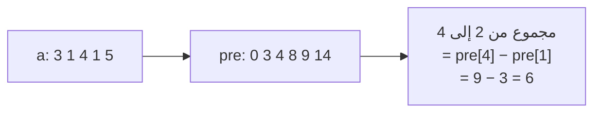

# مسائل Ad-hoc: التكرار و Prefix Sum

**Ad-hoc** تعني مسائل لا تحتاج خوارزمية مشهورة، بل **ملاحظة ذكية** خاصة بالمسألة. هي أكثر مسائل المسابقات للمبتدئين. أدوات تساعدك فيها:

## 1. Frequency Array

بدل أن تبحث عن كل رقم في الـ array كل مرة (O(n) لكل بحث)، احسب عدد مرات ظهور كل قيمة **مرة واحدة**:

```cpp
// القيم بين 1 و 10^6
vector<int> freq(1000001, 0);
for (int x : a) freq[x]++;

// كم مرة ظهر الرقم 7؟ في O(1)
cout << freq[7] << "\n";
```

استخدامات: أكثر عنصر تكرارًا، هل يوجد عنصر مكرر، هل كلمتان من نفس الحروف (anagram):

```cpp
int f[26] = {};
for (char c : s) f[c - 'a']++;
for (char c : t) f[c - 'a']--;
bool same = true;
for (int i = 0; i < 26; i++) if (f[i] != 0) same = false;
```

إذا كانت القيم كبيرة جدًا (حتى 10⁹)، استخدم `map<int,int>` بدل الـ array (درس STL).

## 2. Prefix Sum

السؤال: لدينا array و q سؤال، كل سؤال: "ما مجموع العناصر من l إلى r؟". الحل المباشر O(n) لكل سؤال، أي O(n × q): بطيء إذا كان n و q حتى 10⁵.

الفكرة: نحسب مرة واحدة `pre[i]` = مجموع أول i عنصر:

```cpp
vector<long long> pre(n + 1, 0);
for (int i = 1; i <= n; i++) pre[i] = pre[i - 1] + a[i];   // a مرقّمة من 1

// مجموع من l إلى r في O(1)
long long ans = pre[r] - pre[l - 1];
```



التعقيد: O(n) للتجهيز + O(1) لكل سؤال.

## 3. Difference Array

العكس: q عملية "أضف x لكل العناصر من l إلى r"، ثم اطبع الـ array:

```cpp
vector<long long> d(n + 2, 0);
// لكل عملية:
d[l] += x;
d[r + 1] -= x;
// في النهاية: Prefix Sum لـ d يعطي الإضافة لكل عنصر
long long run = 0;
for (int i = 1; i <= n; i++) { run += d[i]; a[i] += run; }
```

## 4. ملاحظات ذكية

كثير من مسائل Ad-hoc تُحل بسؤال نفسك:
- **ما الذي لا يتغير** (invariant) مهما فعلنا؟ مثلًا مجموع العناصر، أو زوجية (parity) الرقم.
- **ماذا يحدث في الحالات الصغيرة؟** جرّب n = 1، 2، 3 يدويًا وابحث عن نمط.
- **هل الترتيب يسهّل المسألة؟** ترتيب الـ array كثيرًا ما يكشف الحل.
- **هل هناك معادلة مباشرة؟** مجموع 1..n = n(n+1)/2، بدون لفّة.

## تدرّب

شيت Ad-Hocs في Level 0 (رابط المجموعة في التحميلات). مسائل مشهورة مشابهة: Team (231A)، Stones on the Table (266A)، Queue at the School (266B).

## فيديوهات اختيارية

الدرس أعلاه كامل وحده ويعمل بدون إنترنت. هذه جلسة ICPC Mansoura Community الأصلية لنفس الموضوع، إن أردت التعمّق بالمشاهدة (الجلسات طويلة، شاهدها على أجزاء).

**المستوى 0، الجلسة 4: Ad-Hocs**

https://www.youtube.com/watch?v=us7rcbGxq0g
