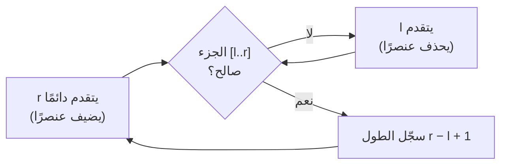

# Ad-hoc و Two Pointers

مع بداية Level 1 تصبح المسائل أصعب قليلًا، والـ constraints أكبر (n حتى 2 × 10⁵)، فلا يصلح O(n²). أول تقنية مهمة: **Two Pointers**.

## الفكرة

بدل لفّتين متداخلتين (لكل i جرّب كل j)، نحرّك Two Pointers **في نفس الاتجاه أو من الطرفين**، وكل مؤشر يتحرك n مرة على الأكثر: O(n).

## من الطرفين: زوج مجموعه x في array مرتبة

```cpp
sort(a.begin(), a.end());
int l = 0, r = n - 1;
bool found = false;
while (l < r) {
    long long s = a[l] + a[r];
    if (s == x) { found = true; break; }
    if (s < x) l++;      // نحتاج مجموعًا أكبر
    else r--;            // نحتاج مجموعًا أصغر
}
```

لماذا صحيح؟ لأن الـ array مرتبة: تحريك `l` يزيد المجموع، وتحريك `r` ينقصه، فكل خطوة تستبعد عنصرًا لا يمكن أن يكون جزءًا من الحل.

## في نفس الاتجاه: أطول جزء مجموعه ≤ s

```cpp
// الأرقام موجبة
int best = 0, l = 0;
long long sum = 0;
for (int r = 0; r < n; r++) {
    sum += a[r];                       // وسّع من اليمين
    while (sum > s) sum -= a[l++];     // ضيّق من اليسار حتى يصبح صالحًا
    best = max(best, r - l + 1);
}
```



كل من `l` و`r` يتحرك n مرة على الأكثر، فالمجموع O(n) رغم وجود `while` داخل `for`.

هذه التقنية تسمى أيضًا **Sliding Window**، وتنفع عندما يكون السؤال عن **جزء متصل** من الـ array.

**تنبيه**: تعمل فقط إذا كان توسيع النافذة لا يمكن أن "يصلح" نافذة غير صالحة. مع وجود أرقام سالبة تفشل الفكرة، ونحتاج Prefix Sum مع `map`.

## دمج مصفوفتين مرتبتين

```cpp
int i = 0, j = 0;
vector<int> c;
while (i < n && j < m) {
    if (a[i] <= b[j]) c.push_back(a[i++]);
    else c.push_back(b[j++]);
}
while (i < n) c.push_back(a[i++]);
while (j < m) c.push_back(b[j++]);
```

## متى أفكر في Two Pointers؟

- الـ array **مرتبة** (أو يمكن ترتيبها دون أن نخسر شيئًا).
- السؤال عن **زوج** أو **جزء متصل** بشرط ما.
- الحل المباشر O(n²) والـ constraints تتطلب O(n) أو O(n log n).

## تدرّب

شيت Adhocs & Two Pointers في Level 1 (مجموعة vjudge أو Codeforces في التحميلات).

## فيديوهات اختيارية

الدرس أعلاه كامل وحده ويعمل بدون إنترنت. هذه جلسة ICPC Mansoura Community الأصلية لنفس الموضوع، إن أردت التعمّق بالمشاهدة (الجلسات طويلة، شاهدها على أجزاء).

**المستوى 1، الجلسة 1: Ad-Hocs و Two Pointers**

https://www.youtube.com/watch?v=gOK0JyiEkWI
