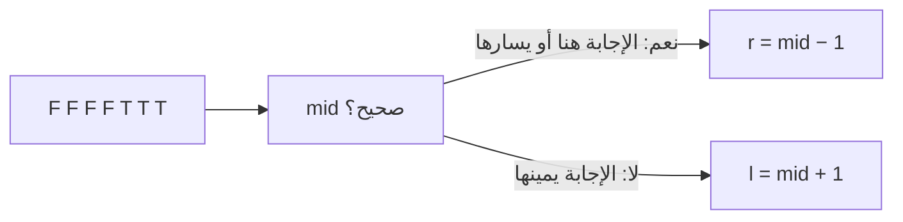

# البحث الثنائي (Binary Search)

البحث الثنائي يجد شيئًا في بيانات **مرتبة** بتقسيم مجال البحث للنصف كل خطوة: O(log n). في مليون عنصر، حوالي 20 خطوة فقط.

## الشكل الأساسي

```cpp
int l = 0, r = n - 1, pos = -1;
while (l <= r) {
    int mid = l + (r - l) / 2;     // أفضل من (l+r)/2 لتجنب overflow
    if (a[mid] == x) { pos = mid; break; }
    if (a[mid] < x) l = mid + 1;
    else r = mid - 1;
}
```

## الشكل الأهم: أول موضع يصبح فيه الشرط صحيحًا

تخيّل الشرط على المجال هكذا: `false false false true true true`. نريد **أول true**:

```cpp
int l = lo, r = hi, ans = hi + 1;
while (l <= r) {
    int mid = l + (r - l) / 2;
    if (ok(mid)) { ans = mid; r = mid - 1; }   // صحيح: احفظه وابحث يسارًا
    else l = mid + 1;
}
```



`lower_bound` و`upper_bound` في STL تعمل بهذه الطريقة بالضبط.

## البحث الثنائي على الإجابة

أقوى استخدام: المسألة لا تبدو بحثًا، لكن يمكنك أن تسأل "**هل الإجابة X تكفي؟**"، وإذا كانت X تكفي فكل ما هو أكبر منها يكفي أيضًا.

مثال: n آلة، الآلة i تصنع منتجًا كل `t[i]` ثانية. أقل وقت لصنع k منتج؟

```cpp
bool ok(long long T) {              // هل نصنع k منتج في T ثانية؟
    long long made = 0;
    for (int i = 0; i < n; i++) {
        made += T / t[i];
        if (made >= k) return true; // توقف قبل أن يكبر الرقم جدًا
    }
    return false;
}

long long l = 1, r = 1e18, ans = r;
while (l <= r) {
    long long mid = l + (r - l) / 2;
    if (ok(mid)) { ans = mid; r = mid - 1; }
    else l = mid + 1;
}
```

التعقيد: O(n × log(10¹⁸)) ≈ O(60n). بدون البحث الثنائي مستحيل.

علامات هذا النوع:
- "أقل قيمة بحيث..." أو "أكبر قيمة بحيث...".
- الإجابة رقم كبير جدًا (حتى 10⁹ أو 10¹⁸).
- يسهل **التحقق** من إجابة معينة، ويصعب **إيجادها** مباشرة.

## البحث الثنائي على أرقام عشرية

```cpp
double l = 0, r = 1e9;
for (int it = 0; it < 100; it++) {   // عدد ثابت من المرات بدل شرط التوقف
    double mid = (l + r) / 2;
    if (ok(mid)) r = mid; else l = mid;
}
```

## أخطاء شائعة

- لفّة لا تنتهي بسبب `l = mid` بدل `mid + 1`.
- نسيان أن المصفوفة يجب أن تكون مرتبة.
- overflow في `mid` أو في دالة التحقق: استخدم `long long`.
- الشرط ليس "رتيبًا" (monotonic): يتحول من false إلى true ثم يعود false، فلا يصلح البحث الثنائي.

## تدرّب

شيت Binary Search في Level 1. ومن Codeforces EDU (مجاني): قسم Binary Search فيه شرح وتمارين ممتازة.
