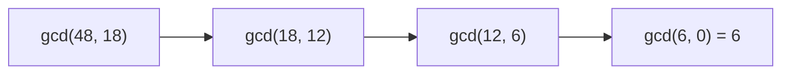

# نظرية الأعداد 1: القسمة، الأعداد الأولية، و GCD

## القواسم (Divisors)

كل قاسم d لـ n يقابله قاسم n/d، وأحدهما ≤ √n. لذلك نجد كل القواسم في O(√n):

```cpp
vector<long long> divs;
for (long long d = 1; d * d <= n; d++) {
    if (n % d == 0) {
        divs.push_back(d);
        if (d != n / d) divs.push_back(n / d);
    }
}
```

## الأعداد الأولية

### اختبار رقم واحد: O(√n)

```cpp
bool isPrime(long long n) {
    if (n < 2) return false;
    for (long long d = 2; d * d <= n; d++)
        if (n % d == 0) return false;
    return true;
}
```

### غربال إراتوستينس (Sieve): كل الأوليات حتى N

إذا سُئلت عن أرقام كثيرة، جهّز مرة واحدة:

```cpp
const int N = 1e6;
vector<bool> composite(N + 1, false);
composite[0] = composite[1] = true;
for (int i = 2; 1LL * i * i <= N; i++)
    if (!composite[i])
        for (int j = i * i; j <= N; j += i)
            composite[j] = true;     // كل مضاعفات i ليست أولية
```

التعقيد O(N log log N): سريع جدًا. بعدها "هل x أولي؟" في O(1).

## التحليل لعوامل أولية

```cpp
map<long long, int> factorize(long long n) {
    map<long long, int> f;
    for (long long p = 2; p * p <= n; p++)
        while (n % p == 0) { f[p]++; n /= p; }
    if (n > 1) f[n]++;          // ما تبقى أولي
    return f;
}
// 360 = 2^3 × 3^2 × 5
```

من التحليل: عدد القواسم = حاصل ضرب (الأس + 1). لـ 360: (3+1)(2+1)(1+1) = 24 قاسمًا.

## القاسم المشترك الأكبر (GCD) والمضاعف المشترك الأصغر (LCM)

خوارزمية إقليدس: gcd(a, b) = gcd(b, a mod b)، وتنتهي عندما يصبح b صفرًا. سريعة جدًا: O(log min(a, b)).

```cpp
long long g = __gcd(a, b);        // أو gcd(a, b) في C++17
long long l = a / g * b;          // LCM: اقسم أولًا لتجنب overflow
```



خصائص مفيدة:
- gcd(a, 0) = a.
- gcd لمصفوفة كاملة: طبّقه عنصرًا بعد عنصر.
- a × b = gcd × lcm.

## باقي القسمة (Modulo)

المسائل تقول كثيرًا "اطبع الإجابة mod 10⁹+7" لأن الرقم ضخم. القواعد:

```cpp
const long long MOD = 1e9 + 7;
(a + b) % MOD
(a - b + MOD) % MOD        // لتجنب النتيجة السالبة
(a % MOD) * (b % MOD) % MOD
```

**القسمة لا تعمل هكذا مباشرة**؛ تحتاج "المعكوس الضربي" (الدرس القادم).

## تدرّب

شيت Number Theory 1 في Level 1.

## فيديوهات اختيارية

الدرس أعلاه كامل وحده ويعمل بدون إنترنت. هذه جلسة ICPC Mansoura Community الأصلية لنفس الموضوع، إن أردت التعمّق بالمشاهدة (الجلسات طويلة، شاهدها على أجزاء).

**المستوى 1، الجلسة 3: نظرية الأعداد 1**

https://www.youtube.com/watch?v=Vp9MMqbOvKo
