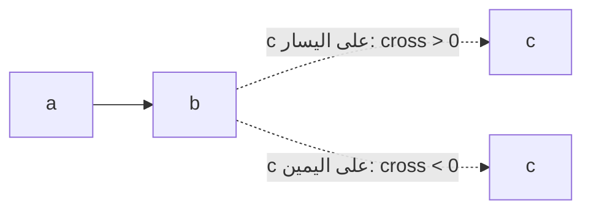

# الهندسة الحسابية: الأساسيات

مسائل الهندسة في المسابقات تعتمد على أدوات قليلة تتكرر. السر: **استخدم الأعداد الصحيحة كلما أمكن**، لأن الأرقام العشرية تسبب أخطاء تقريب.

## النقاط والمتجهات

```cpp
struct P {
    long long x, y;
    P operator-(const P &o) const { return {x - o.x, y - o.y}; }
};

long long cross(P a, P b) { return a.x * b.y - a.y * b.x; }   // الضرب الاتجاهي
long long dot(P a, P b)   { return a.x * b.x + a.y * b.y; }   // الضرب القياسي
```

## الضرب الاتجاهي (Cross Product): أهم أداة

`cross(b - a, c - a)` يخبرك باتجاه الالتفاف من a إلى b إلى c:

| الناتج | المعنى |
|---|---|
| أكبر من 0 | c على **يسار** الخط من a إلى b (التفاف عكس عقارب الساعة) |
| أقل من 0 | c على **يمين** الخط (مع عقارب الساعة) |
| يساوي 0 | النقاط الثلاث على **خط واحد** |

```cpp
int orient(P a, P b, P c) {
    long long v = cross(b - a, c - a);
    return (v > 0) - (v < 0);          // 1 أو -1 أو 0
}
```



كل الحسابات بأعداد صحيحة: لا أخطاء تقريب. انتبه: الإحداثيات حتى 10⁹ تعطي ضربًا حتى 10¹⁸، فاستخدم `long long`.

## مساحة مضلع (Shoelace)

مساحة مضلع رؤوسه بالترتيب (p₀, p₁, ..., pₙ₋₁):

```cpp
long long twice = 0;
for (int i = 0; i < n; i++) twice += cross(p[i], p[(i + 1) % n]);
twice = llabs(twice);
// المساحة = twice / 2 (اطبع twice/2 و ".5" إن كان twice فرديًا لتبقى دقيقًا)
```

مساحة مثلث abc = |cross(b − a, c − a)| / 2.

## هل يتقاطع قطعتان مستقيمتان؟

القطعتان ab و cd تتقاطعان إذا كانت c و d على جانبين مختلفين من ab، **و** a و b على جانبين مختلفين من cd. مع معالجة حالة النقاط على خط واحد:

```cpp
bool onSeg(P a, P b, P c) {             // c على القطعة ab (بفرض أنها على نفس الخط)
    return min(a.x, b.x) <= c.x && c.x <= max(a.x, b.x) &&
           min(a.y, b.y) <= c.y && c.y <= max(a.y, b.y);
}
bool intersect(P a, P b, P c, P d) {
    int o1 = orient(a, b, c), o2 = orient(a, b, d);
    int o3 = orient(c, d, a), o4 = orient(c, d, b);
    if (o1 != o2 && o3 != o4) return true;
    if (o1 == 0 && onSeg(a, b, c)) return true;
    if (o2 == 0 && onSeg(a, b, d)) return true;
    if (o3 == 0 && onSeg(c, d, a)) return true;
    if (o4 == 0 && onSeg(c, d, b)) return true;
    return false;
}
```

## المسافات

```cpp
double dist(P a, P b) { return hypot((double)(a.x - b.x), (double)(a.y - b.y)); }
```

للمقارنة بين مسافتين، قارن **مربعيهما** (أعداد صحيحة) بدل الجذر.

## نقاط الشبكة: نظرية بيك (Pick)

لمضلع رؤوسه نقاط صحيحة: المساحة = I + B/2 − 1، حيث I النقاط الصحيحة داخله، و B النقاط على حدوده. وعدد النقاط الصحيحة على قطعة من a إلى b (بدون إحدى النهايتين) = gcd(|dx|, |dy|). هنا تلتقي الهندسة بنظرية الأعداد.

## نصائح

- إذا اضطررت للأعداد العشرية، قارن بسماحية: `fabs(a - b) < 1e-9` بدل `a == b`.
- `acos(-1.0)` تعطي π بدقة.
- ارسم المسألة على الورق دائمًا.

## تدرّب

قسم Geometry في CSES (Point Location Test، Line Segment Intersection، Polygon Area، Point in Polygon)، ومسائل Codeforces بوسم geometry وتصنيف حتى 1400.

## فيديوهات اختيارية

الدرس أعلاه كامل وحده ويعمل بدون إنترنت. لم تنشر ICPC Mansoura جلسة مسجلة لهذا الموضوع، فهذا فيديو اختياري بديل بالإنجليزية، إن أردت التعمّق بالمشاهدة.

**CSES Geometry Problem Set, live solving (Errichto)**

https://www.youtube.com/watch?v=G9QTjWtK_TQ
