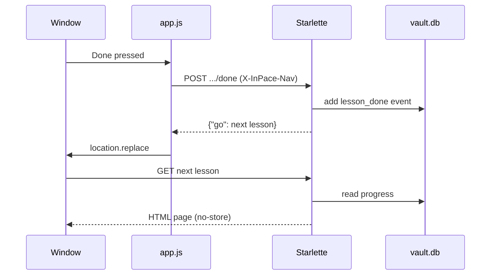

# One click, end to end

Let's follow what happens when you press **Done** on a lesson.

## The pieces

- **The server** (`__main__.py`) picks a free port on `127.0.0.1` (never `0.0.0.0`, so nothing outside the
  device can reach it) and runs Uvicorn with the Starlette app from `create_app(vault)`.
- **The route** writes an **event**. Events are the source of truth: progress is *computed* from events every
  time (`Vault.progress`), never stored as a number that could drift.
- **The answer** is a redirect (Post/Redirect/Get). Because the script sent `X-InPace-Nav`, `NavMiddleware`
  turns the redirect into JSON `{"go": url}`, and the script *replaces* the page, so the sent form never
  sits behind the Back button.
- **The page** is rendered by `page()`: it adds the shared context (your name, language, people you check,
  island news...) and renders a Jinja template. `NavMiddleware` adds `Cache-Control: no-store` to every HTML page,
  so Back always shows the current state.

## A bug worth remembering

When a form brought you back to the same page with a `#section`, the browser only scrolled, so a new colour or a
purchase didn't show. Two fixes: `go()` puts `?ok=` messages *before* the `#`, and `goFresh()` in `app.js`
reloads when only the hash differs. In an interview this is a great "tell me about a tricky bug" story: the
symptom looked like many different bugs, but it was one rule of URL navigation.
