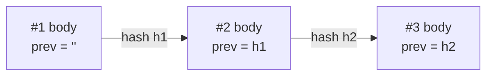

# Milestones as a hash chain, and encrypted backups

## A milestone

A milestone's **body** has a sequence number `seq`, the fingerprint of the previous milestone `prev`, the
`learner` id, the course and a `summary` (percent, lessons, modules, minutes). Its `hash` is the fingerprint of
the body, and `sig` signs `{"kind": "milestone", "hash": hash}` with the learner's key.

`exchange.check_chain` checks, for every milestone: the seq is in order, the hash matches the body, `prev`
points to the one before, and the signature is the learner's. Change one old milestone and every later link
breaks. That's why a checker can trust a file that came through WhatsApp: **the file proves itself**.

What it does *not* prove: that the learner understood the material. That's what the checker's own review,
explain tasks and **verified exams** are for (Day 5). Saying this clearly in an interview shows maturity.

## Encrypted backups

`pace.make_backup` zips your data and encrypts it with a key derived from your password by **Argon2id**
(memory-hard, slows down guessing) and a **SecretBox** (XSalsa20-Poly1305: encryption plus integrity).
The file starts with a magic header `INPACEBK1` and a random salt. A wrong password fails cleanly instead of
restoring garbage, because the Poly1305 tag doesn't match.
