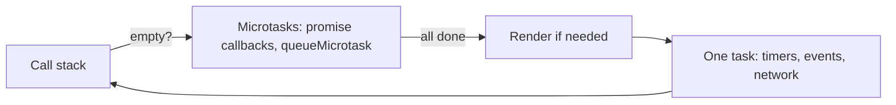

# The event loop

JavaScript runs one piece of code at a time on the main thread. Work waits in queues:



After each task, **all** microtasks run, then the browser may paint, then the next task.

```js
console.log("1");
setTimeout(() => console.log("2"));
Promise.resolve().then(() => console.log("3"));
console.log("4");
// 1 4 3 2
```

A long loop on the main thread blocks clicks and painting (bad INP). Split work, or move it to a Web Worker.
