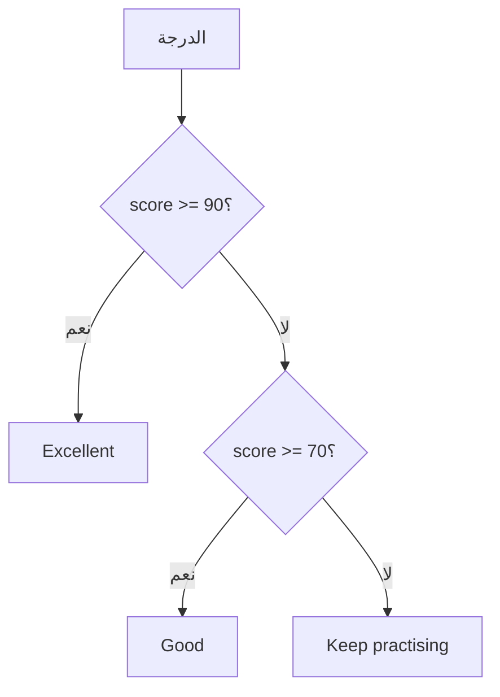

# if و else والمقارنات

> **فيديو اختياري في الأعلى.** جزء من كورس freeCodeCamp *Learn JavaScript, Full Course for Beginners* (بو كارنز)، من 1:08:41 إلى 1:32:15. كل ما تحتاجه موجود في النص أدناه، فشاهده فقط إن كان يفيدك: يحفظ inPace المكان الذي توقفت عنده.
>
> الفيديو بالإنجليزية: إن أردت مشاهدته فشغّل الترجمة (**CC**)، ثم **الإعدادات ← الترجمة ← ترجمة تلقائية ← العربية**.

```javascript
const score = 72;
if (score >= 90) {
  console.log("Excellent");
} else if (score >= 70) {
  console.log("Good");
} else {
  console.log("Keep practising");
}
```



## استخدم دائمًا === و !==

`===` تفحص القيمة **والنوع**، أما `==` فتحوّل الأنواع أولًا وتعطي مفاجآت:

```javascript
console.log(5 == "5");    // true  (converted)
console.log(5 === "5");   // false (number vs string)
console.log(0 == false);  // true
console.log(0 === false); // false
```

## و، أو، ليس

`&&` (الاثنان صحيحان)، و `||` (واحد على الأقل)، و `!` (العكس): `if (age >= 18 && hasId)`.

**القيم الصادقة والكاذبة:** داخل `if` تُعامل هذه كـ false: `false, 0, "", null, undefined, NaN`. وكل ما عداها true، حتى `"0"` و `[]`.
