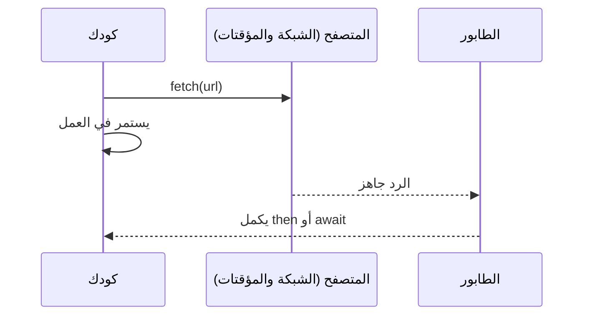

# حلقة الأحداث و promises

تنفّذ JavaScript شيئًا واحدًا في كل مرة. والعمل البطيء (طلب شبكة أو مؤقت) يُسلَّم للمتصفح، وعندما ينتهي ينتظر الـ callback في طابور حتى ينتهي الكود الحالي.



```javascript
console.log("1");
setTimeout(() => console.log("3: after 0 ms, but after the current code"), 0);
console.log("2");

const wait = (ms) => new Promise((resolve) => setTimeout(resolve, ms));
wait(500).then(() => console.log("half a second later"));
```

الـ **promise** قيمة ستصل لاحقًا: *pending* (قيد الانتظار)، ثم *fulfilled* (بقيمة) أو *rejected* (بخطأ).
