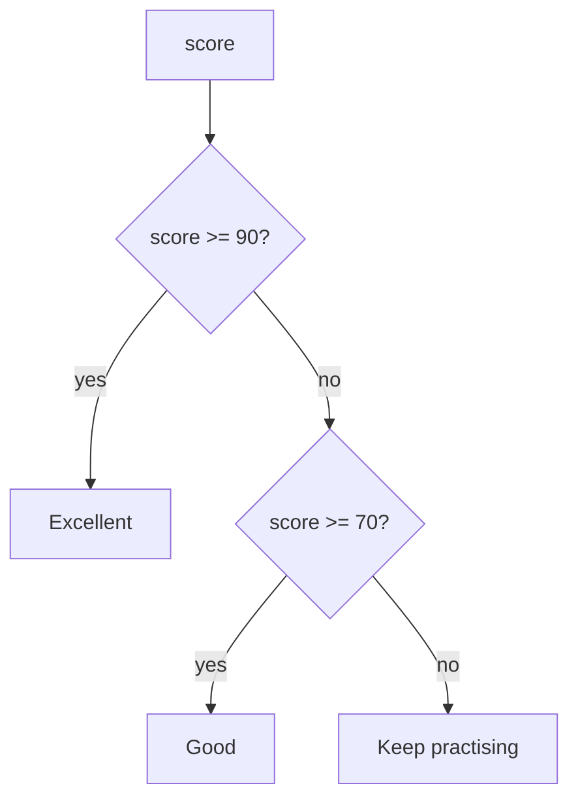

# if, else and comparisons

> **Optional video above.** Part of freeCodeCamp's *Learn JavaScript, Full Course for Beginners* (Beau Carnes), from 1:08:41 to 1:32:15. Everything you need is in the text below, so watch it only if it helps you: inPace remembers where you stopped.

```javascript
const score = 72;
if (score >= 90) {
  console.log("Excellent");
} else if (score >= 70) {
  console.log("Good");
} else {
  console.log("Keep practising");
}
```



## Always use === and !==

`===` checks value **and** type; `==` converts types first and gives surprises:

```javascript
console.log(5 == "5");    // true  (converted)
console.log(5 === "5");   // false (number vs string)
console.log(0 == false);  // true
console.log(0 === false); // false
```

## And, or, not

`&&` (both true), `||` (at least one), `!` (the opposite): `if (age >= 18 && hasId)`.

**Truthy and falsy:** in an `if`, these count as false: `false, 0, "", null, undefined, NaN`. Everything else is true, even `"0"` and `[]`.
