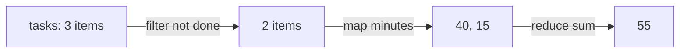

# map, filter, reduce

Three methods you'll use every day. They **return a new array** (or value) and don't change the original.

```javascript
const tasks = [
  { title: "Read", minutes: 25, done: true },
  { title: "Code", minutes: 40, done: false },
  { title: "Quiz", minutes: 15, done: false },
];

const titles = tasks.map((t) => t.title);              // ["Read", "Code", "Quiz"]
const left = tasks.filter((t) => !t.done);             // the 2 not done
const total = left.reduce((sum, t) => sum + t.minutes, 0);  // 55
const first = tasks.find((t) => t.minutes > 30);       // the "Code" task
const anyDone = tasks.some((t) => t.done);             // true
const sorted = [...tasks].sort((a, b) => a.minutes - b.minutes);  // a sorted copy
console.log(titles, left.length, total, first.title, anyDone, sorted[0].title);
```



`sort` changes the array itself and compares as text by default (`[10, 9, 1].sort()` gives `[1, 10, 9]`): always pass a compare function for numbers, and copy first with `[...arr]`.
