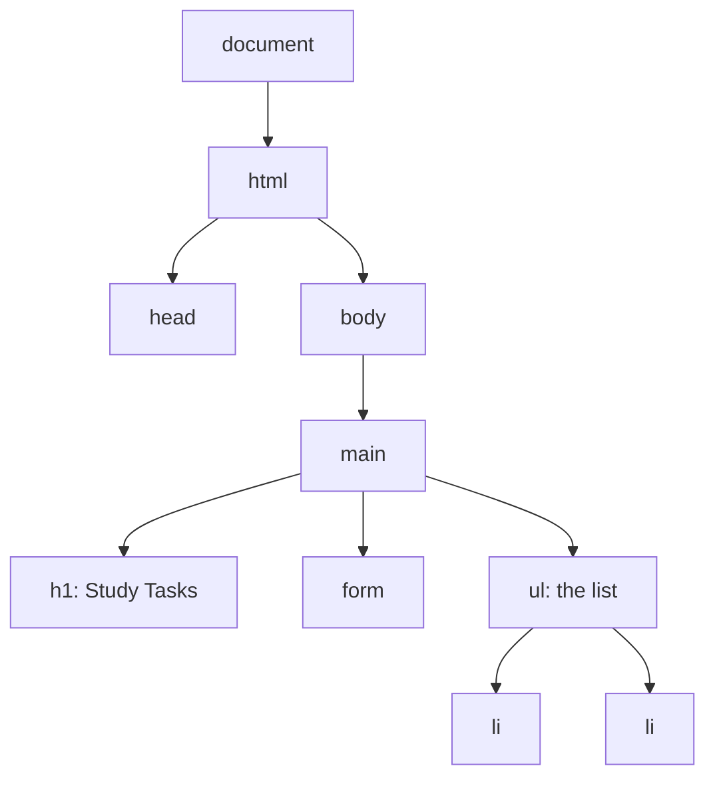

# The DOM: find and change the page

The browser turns your HTML into a tree of objects, the **DOM**. JavaScript reads and changes that tree, and the page updates.



```javascript
const title = document.querySelector("h1");          // the first match (CSS selector)
const items = document.querySelectorAll("li");       // all matches
title.textContent = "My Study Plan";                 // change the text
title.classList.add("big");                          // add a CSS class
title.style.color = "crimson";                       // change a style

const li = document.createElement("li");             // make a new element
li.textContent = "Read chapter 3";
document.querySelector("ul").append(li);             // put it on the page
li.remove();                                         // and take it away
```

**Security:** put user text in with `textContent`, never `innerHTML`. With innerHTML, text like `` would run as code (an XSS attack).
