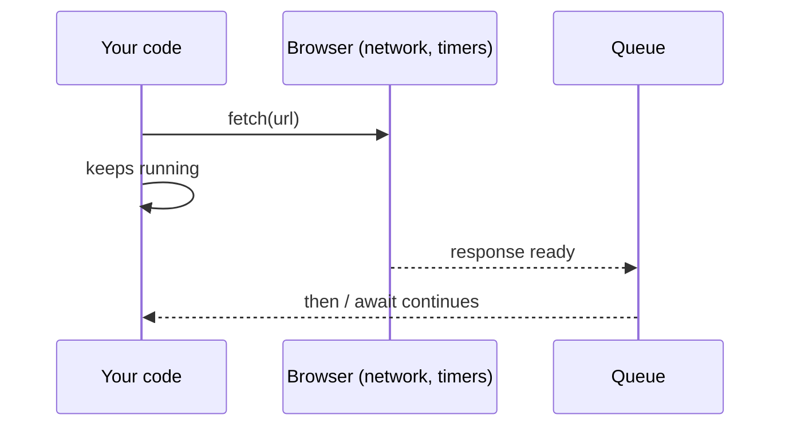

# The event loop and promises

JavaScript runs one thing at a time. Slow work (a network request, a timer) is handed to the browser; when it's done, a callback waits in a queue until the current code finishes.



```javascript
console.log("1");
setTimeout(() => console.log("3: after 0 ms, but after the current code"), 0);
console.log("2");

const wait = (ms) => new Promise((resolve) => setTimeout(resolve, ms));
wait(500).then(() => console.log("half a second later"));
```

A **promise** is a value that will arrive later: *pending*, then *fulfilled* (with a value) or *rejected* (with an error).
