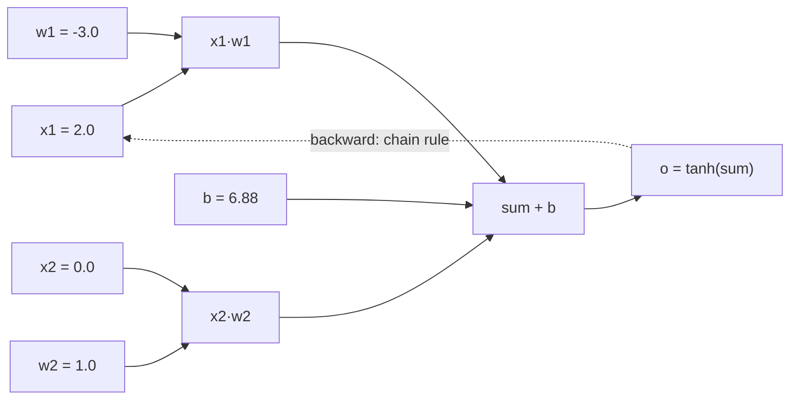

# micrograd 1: derivatives and a tiny autograd engine

This course follows Andrej Karpathy's YouTube series **Neural Networks: Zero to Hero**, in the same order. Each lesson explains the video's ideas in text with short code you can run, so it's complete without the videos; the videos (linked at the end of each lesson) show the full build, typed live, in one to two hours each.

| Resource | Link |
|---|---|
| Series page | [karpathy.ai/zero-to-hero.html](https://karpathy.ai/zero-to-hero.html) |
| Lecture notebooks | [github.com/karpathy/nn-zero-to-hero](https://github.com/karpathy/nn-zero-to-hero) |
| This lesson's repository | [github.com/karpathy/micrograd](https://github.com/karpathy/micrograd) |

You need Python and a little calculus intuition; everything else is built from zero.

## What a derivative tells you

The derivative of f at x answers: if I nudge x up a tiny bit h, how much does f change, per unit of h?

```python
def f(x):
    return 3 * x ** 2 - 4 * x + 5

h = 1e-6
x = 3.0
print((f(x + h) - f(x)) / h)          # about 14: f'(x) = 6x - 4 = 14 at x = 3
```

Training a neural network is exactly this question asked for millions of weights at once: how does the **loss** change when each weight changes? Then nudge every weight in the direction that lowers the loss.

## A value that remembers where it came from

micrograd's core is a `Value`: a number that records which operation produced it and from which inputs. Running the computation builds a graph; walking it backwards with the **chain rule** gives every gradient.

```python
import math

class Value:
    def __init__(self, data, _children=(), _op=""):
        self.data, self.grad = data, 0.0
        self._prev, self._op = set(_children), _op
        self._backward = lambda: None

    def __add__(self, other):
        other = other if isinstance(other, Value) else Value(other)
        out = Value(self.data + other.data, (self, other), "+")
        def _backward():
            self.grad += out.grad                 # d(a+b)/da = 1
            other.grad += out.grad
        out._backward = _backward
        return out

    def __mul__(self, other):
        other = other if isinstance(other, Value) else Value(other)
        out = Value(self.data * other.data, (self, other), "*")
        def _backward():
            self.grad += other.data * out.grad    # d(a·b)/da = b
            other.grad += self.data * out.grad
        out._backward = _backward
        return out

    def tanh(self):
        t = math.tanh(self.data)
        out = Value(t, (self,), "tanh")
        def _backward():
            self.grad += (1 - t ** 2) * out.grad  # d tanh(x)/dx = 1 - tanh²(x)
        out._backward = _backward
        return out

    def backward(self):
        topo, seen = [], set()
        def build(v):                              # order nodes so each comes after its inputs
            if v not in seen:
                seen.add(v)
                for child in v._prev:
                    build(child)
                topo.append(v)
        build(self)
        self.grad = 1.0
        for v in reversed(topo):
            v._backward()

    __radd__ = __add__
    __rmul__ = __mul__
    def __neg__(self): return self * -1
    def __sub__(self, other): return self + (-other)
    def __repr__(self): return f"Value(data={self.data:.4f}, grad={self.grad:.4f})"
```



## One neuron, by hand and by backward()

```python
x1, x2 = Value(2.0), Value(0.0)
w1, w2 = Value(-3.0), Value(1.0)
b = Value(6.8813735870195432)
o = (x1 * w1 + x2 * w2 + b).tanh()
o.backward()
print(o, w1, x1)          # o ≈ 0.7071, w1.grad ≈ 1.0, x1.grad ≈ -1.5
```

Why `+=` in every `_backward`? When a value is used twice (`a + a`), gradients from both uses must **add up**; plain `=` would overwrite one. It's the same reason PyTorch accumulates gradients.

## Optional videos

The lesson above is complete on its own. These go deeper, if you like learning by watching.

**The spelled-out intro to neural networks and backpropagation: building micrograd (Andrej Karpathy)**

https://www.youtube.com/watch?v=VMj-3S1tku0

**Backpropagation, intuitively (3Blue1Brown, chapter 3)**

https://www.youtube.com/watch?v=Ilg3gGewQ5U
