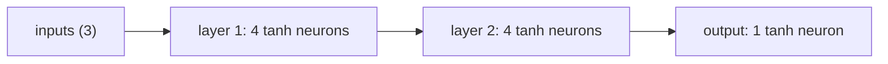

# micrograd 2: neurons, an MLP and gradient descent

With `Value` from the last lesson, a whole neural network is a few classes. This is micrograd's `nn.py`, nearly line for line.

```python
import random
random.seed(1337)

class Neuron:
    def __init__(self, nin):
        self.w = [Value(random.uniform(-1, 1)) for _ in range(nin)]
        self.b = Value(random.uniform(-1, 1))
    def __call__(self, x):
        act = sum((wi * xi for wi, xi in zip(self.w, x)), self.b)
        return act.tanh()
    def parameters(self):
        return self.w + [self.b]

class Layer:
    def __init__(self, nin, nout):
        self.neurons = [Neuron(nin) for _ in range(nout)]
    def __call__(self, x):
        outs = [n(x) for n in self.neurons]
        return outs[0] if len(outs) == 1 else outs
    def parameters(self):
        return [p for n in self.neurons for p in n.parameters()]

class MLP:
    def __init__(self, nin, nouts):
        sizes = [nin] + nouts
        self.layers = [Layer(sizes[i], sizes[i + 1]) for i in range(len(nouts))]
    def __call__(self, x):
        for layer in self.layers:
            x = layer(x)
        return x
    def parameters(self):
        return [p for layer in self.layers for p in layer.parameters()]

net = MLP(3, [4, 4, 1])
print(len(net.parameters()), "parameters")          # 41
```



## Training loop: forward, loss, zero grads, backward, update

```python
xs = [[2.0, 3.0, -1.0], [3.0, -1.0, 0.5], [0.5, 1.0, 1.0], [1.0, 1.0, -1.0]]
ys = [1.0, -1.0, -1.0, 1.0]                          # desired outputs

for step in range(100):
    preds = [net(x) for x in xs]                                     # forward
    loss = sum(((p - y) * (p - y) for p, y in zip(preds, ys)), Value(0.0))   # squared error
    for p in net.parameters():
        p.grad = 0.0                                                  # zero the gradients first!
    loss.backward()                                                   # backward
    for p in net.parameters():
        p.data -= 0.05 * p.grad                                       # gradient descent
    if step % 25 == 0:
        print(step, round(loss.data, 4))
print([round(p.data, 3) for p in preds])               # close to [1, -1, -1, 1]
```

Karpathy shows a bug live in the video that everyone makes once: forgetting to zero the gradients. Because `_backward` uses `+=`, gradients from earlier steps pile up and training goes wrong in subtle ways. PyTorch has the exact same rule (`opt.zero_grad()`).

## From micrograd to PyTorch

micrograd works on single numbers (scalars); PyTorch does the same on **tensors**, millions of numbers per operation, on GPUs. The API is deliberately similar:

```python
import torch
x = torch.tensor([2.0, 0.0])
w = torch.tensor([-3.0, 1.0], requires_grad=True)
b = torch.tensor(6.8813735870195432, requires_grad=True)
o = torch.tanh(x @ w + b)
o.backward()
print(round(o.item(), 4), w.grad.tolist())       # same numbers as micrograd: 0.7071, [1.0, 0.0]
```

**Repository:** the whole engine is about 100 lines in [micrograd/engine.py](https://github.com/karpathy/micrograd/blob/master/micrograd/engine.py), with a demo notebook that trains a classifier on a 2-D dataset.

## Optional videos

The lesson above is complete on its own. These go deeper, if you like learning by watching.

**The spelled-out intro to neural networks and backpropagation: building micrograd (Andrej Karpathy)**

https://www.youtube.com/watch?v=VMj-3S1tku0
