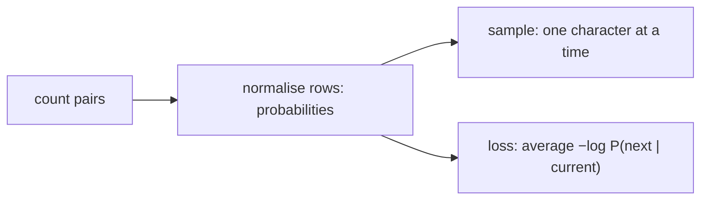

# makemore 1: a bigram model by counting

**makemore** learns from a list of names and makes up new ones that sound like names. It's the project behind the next five videos, growing from counting to a WaveNet. The dataset is **names.txt**: 32,033 common names (from a US government name list), one per line.

| Resource | Link |
|---|---|
| Repository | [github.com/karpathy/makemore](https://github.com/karpathy/makemore) |
| Dataset | [names.txt](https://raw.githubusercontent.com/karpathy/makemore/master/names.txt) |

```python
import os, urllib.request
if not os.path.exists("names.txt"):                       # 32,033 names from the makemore repository
    urllib.request.urlretrieve("https://raw.githubusercontent.com/karpathy/makemore/master/names.txt", "names.txt")
words = open("names.txt").read().splitlines()
print(len(words), words[:5])
```

## The bigram idea

A **bigram** model predicts the next character from the current one only. Wrap each name with a special start/end token `.`: "emma" gives the pairs `.e`, `em`, `mm`, `ma`, `a.`.

```python
import torch

chars = sorted(set("".join(words)))
stoi = {c: i + 1 for i, c in enumerate(chars)}
stoi["."] = 0
itos = {i: c for c, i in stoi.items()}

N = torch.zeros((27, 27), dtype=torch.int32)
for w in words:
    seq = ["."] + list(w) + ["."]
    for a, b in zip(seq, seq[1:]):
        N[stoi[a], stoi[b]] += 1
print("most common first letters:", [itos[i] for i in N[0].topk(5).indices.tolist()])
```

`N[i, j]` counts how often character j follows character i. Normalising each row gives probabilities:

```python
P = (N + 1).float()                  # +1 smoothing: no zero probabilities
P /= P.sum(dim=1, keepdim=True)      # broadcasting divides each row by its sum

g = torch.Generator().manual_seed(2147483647)
for _ in range(5):
    out, ix = [], 0
    while True:
        ix = torch.multinomial(P[ix], num_samples=1, generator=g).item()
        if ix == 0:
            break
        out.append(itos[ix])
    print("".join(out))
```

The names are bad (a bigram has very little context), but they already look more like names than random letters.

## Measuring quality: negative log likelihood

How good is a model? Multiply the probabilities it assigns to every real pair in the data: higher is better. Products of many small numbers underflow, so take logs, negate, and average: the **average negative log likelihood** (NLL), the loss used for all of makemore. Lower is better.

```python
log_likelihood, n = 0.0, 0
for w in words:
    seq = ["."] + list(w) + ["."]
    for a, b in zip(seq, seq[1:]):
        log_likelihood += torch.log(P[stoi[a], stoi[b]])
        n += 1
print(f"average NLL: {(-log_likelihood / n).item():.4f}")   # about 2.45
```



A model guessing uniformly among 27 characters would score ln(27) ≈ 3.30; the bigram gets about 2.45. Every later model is judged by this number on held-out data.

## Optional videos

The lesson above is complete on its own. These go deeper, if you like learning by watching.

**The spelled-out intro to language modeling: building makemore (Andrej Karpathy)**

https://www.youtube.com/watch?v=PaCmpygFfXo
