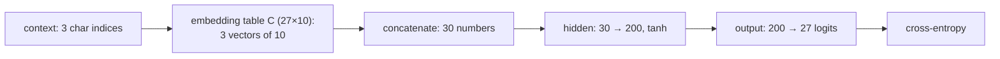

# makemore 2: an MLP language model

Video 3 implements the model from Bengio et al., *A Neural Probabilistic Language Model* (2003): look at the last **3 characters**, map each to a learned **embedding** vector, concatenate, pass through a hidden layer, and predict the next character.



```python
import random
import torch
import torch.nn.functional as F

import os, urllib.request
if not os.path.exists("names.txt"):                       # 32,033 names from the makemore repository
    urllib.request.urlretrieve("https://raw.githubusercontent.com/karpathy/makemore/master/names.txt", "names.txt")
words = open("names.txt").read().splitlines()

chars = sorted(set("".join(words)))
stoi = {c: i + 1 for i, c in enumerate(chars)}; stoi["."] = 0
itos = {i: c for c, i in stoi.items()}
block_size = 3                                     # context length

def build_dataset(ws):
    X, Y = [], []
    for w in ws:
        context = [0] * block_size
        for ch in w + ".":
            X.append(context); Y.append(stoi[ch])
            context = context[1:] + [stoi[ch]]     # slide the window
    return torch.tensor(X), torch.tensor(Y)

random.seed(42); random.shuffle(words)
n1, n2 = int(0.8 * len(words)), int(0.9 * len(words))
Xtr, Ytr = build_dataset(words[:n1])               # 80% train
Xdev, Ydev = build_dataset(words[n1:n2])           # 10% dev (validation)
Xte, Yte = build_dataset(words[n2:])               # 10% test
print(Xtr.shape, Xdev.shape, Xte.shape)

g = torch.Generator().manual_seed(2147483647)
C = torch.randn((27, 10), generator=g)
W1 = torch.randn((30, 200), generator=g) * 0.2
b1 = torch.randn(200, generator=g) * 0.01
W2 = torch.randn((200, 27), generator=g) * 0.01
b2 = torch.zeros(27)
parameters = [C, W1, b1, W2, b2]
for p in parameters:
    p.requires_grad = True

for step in range(20000):                          # the video trains 200,000 steps; this is enough to see it work
    ix = torch.randint(0, Xtr.shape[0], (32,), generator=g)   # minibatch of 32
    emb = C[Xtr[ix]]                               # (32, 3, 10)
    h = torch.tanh(emb.view(-1, 30) @ W1 + b1)
    logits = h @ W2 + b2
    loss = F.cross_entropy(logits, Ytr[ix])
    for p in parameters:
        p.grad = None
    loss.backward()
    lr = 0.1 if step < 15000 else 0.01             # step decay
    for p in parameters:
        p.data += -lr * p.grad

@torch.no_grad()
def split_loss(X, Y):
    h = torch.tanh(C[X].view(-1, 30) @ W1 + b1)
    return F.cross_entropy(h @ W2 + b2, Y).item()
print(f"train {split_loss(Xtr, Ytr):.3f}  dev {split_loss(Xdev, Ydev):.3f}")   # about 2.15 here; the video reaches about 2.17 dev after much longer training
```

## Ideas from this video you'll use forever

- **Embeddings:** `C[X]` looks up a learned vector per character; similar characters (vowels, for example) end up near each other.
- **Minibatches:** a gradient from 32 random examples is noisy but cheap; many cheap steps beat few exact ones.
- **Train / dev / test splits:** tune on dev, report test once. A train loss far below dev means overfitting.
- **Finding a learning rate:** try a range on a log scale and plot loss against it; Karpathy finds 0.1 this way.

## Sampling names

```python
for _ in range(5):
    out, context = [], [0] * block_size
    while True:
        h = torch.tanh(C[torch.tensor([context])].view(1, -1) @ W1 + b1)
        ix = torch.multinomial(F.softmax(h @ W2 + b2, dim=1), 1, generator=g).item()
        context = context[1:] + [ix]
        if ix == 0:
            break
        out.append(itos[ix])
    print("".join(out))
```

## Optional videos

The lesson above is complete on its own. These go deeper, if you like learning by watching.

**Building makemore Part 2: MLP (Andrej Karpathy)**

https://www.youtube.com/watch?v=TCH_1BHY58I
