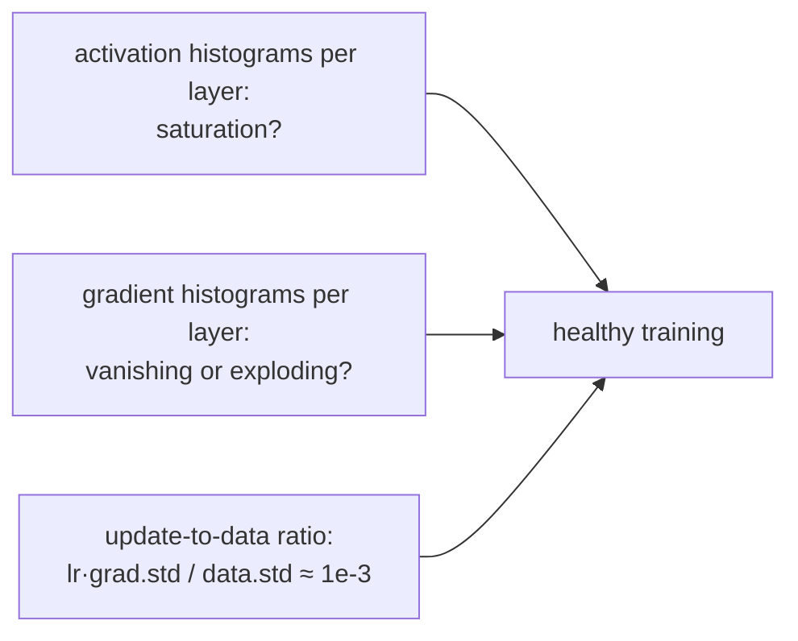

# makemore 3: activations, initialisation and BatchNorm

Video 4 is about what happens **inside** a network during training, and how to keep it healthy. It continues with the MLP from the last lesson (same data and variables).

## 1. The loss at initialisation

With 27 characters and no knowledge, the right starting loss is −ln(1/27) ≈ 3.30. A random network that starts at 27 is confidently wrong and wastes its first thousands of steps undoing it. Fix: make the output layer small at init (`W2 * 0.01`, `b2 = 0`), as we did.

```python
import math
print("expected initial loss:", round(-math.log(1 / 27), 3))
g2 = torch.Generator().manual_seed(1)
bad_W2 = torch.randn((200, 27), generator=g2)              # large output weights
h0 = torch.tanh(C[Xtr[:1000]].view(-1, 30) @ W1 + b1).detach()
print("loss with large output weights:", round(F.cross_entropy(h0 @ bad_W2, Ytr[:1000]).item(), 2))
```

## 2. Saturated tanh

If pre-activations are large, `tanh` outputs sit at ±1, where its gradient `1 − t²` is about 0: those neurons barely learn ("dead" or saturated).

```python
raw_W1 = torch.randn((30, 200), generator=g2)              # no scaling
pre = C[Xtr[:1000]].detach().view(-1, 30) @ raw_W1
for name, w in [("unscaled", raw_W1), ("kaiming-scaled", raw_W1 * (5 / 3) / 30 ** 0.5)]:
    hpre = C[Xtr[:1000]].detach().view(-1, 30) @ w
    t = torch.tanh(hpre)
    print(f"{name}: pre-activation std {hpre.std():.2f}, saturated (|t|>0.99) {(t.abs() > 0.99).float().mean():.1%}")
```

**Kaiming initialisation** scales weights by gain / √fan_in (gain 5/3 for tanh) so activations keep a healthy spread layer after layer. In PyTorch: `torch.nn.init.kaiming_normal_`.

## 3. Batch normalisation

BatchNorm (Ioffe and Szegedy, 2015) normalises each hidden unit's pre-activations over the batch to mean 0 and standard deviation 1, then lets the network rescale them with learned `gain` and `bias`. Activations stay well-behaved even in deep networks.

```python
class BatchNorm1d:
    def __init__(self, dim, eps=1e-5, momentum=0.1):
        self.eps, self.momentum, self.training = eps, momentum, True
        self.gamma, self.beta = torch.ones(dim), torch.zeros(dim)
        self.running_mean, self.running_var = torch.zeros(dim), torch.ones(dim)

    def __call__(self, x):
        if self.training:
            mean, var = x.mean(0, keepdim=True), x.var(0, keepdim=True)
        else:
            mean, var = self.running_mean, self.running_var        # inference: fixed statistics
        out = self.gamma * (x - mean) / torch.sqrt(var + self.eps) + self.beta
        if self.training:
            with torch.no_grad():
                self.running_mean = (1 - self.momentum) * self.running_mean + self.momentum * mean
                self.running_var = (1 - self.momentum) * self.running_var + self.momentum * var
        return out

bn = BatchNorm1d(200)
y_bn = bn(pre)
print(f"after BatchNorm: mean {y_bn.mean():.3f}, std {y_bn.std():.3f}")
```

Side effects to know: in training, each example's output depends on the rest of its batch (a mild regulariser, and a source of bugs); at inference, running statistics replace batch statistics (hence `model.eval()`). Modern transformers use **LayerNorm** (normalise over features, per example) instead, which has no batch dependence.

## 4. Diagnostics worth plotting



The update-to-data ratio is Karpathy's favourite: if updates are about a thousandth of the weights' size, the learning rate is in a good range.

## Optional videos

The lesson above is complete on its own. These go deeper, if you like learning by watching.

**Building makemore Part 3: Activations and Gradients, BatchNorm (Andrej Karpathy)**

https://www.youtube.com/watch?v=P6sfmUTpUmc
