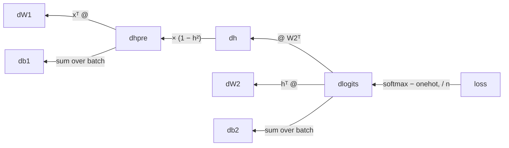

# makemore 4: becoming a backprop ninja

Video 5 removes `loss.backward()` and computes every gradient of the MLP by hand, tensor by tensor, then checks each against PyTorch. Karpathy's argument (from his essay *Yes you should understand backprop*): backprop is a leaky abstraction; when training misbehaves, you need to know what flows backwards.

## The trick for every step

For each operation in the forward pass, write the local derivative, multiply by the gradient arriving from above (the chain rule), and **sum over any dimension that was broadcast**. Then compare with autograd.

```python
import torch
import torch.nn.functional as F

torch.manual_seed(0)
n, d_in, d_h, k = 32, 30, 64, 27
x = torch.randn(n, d_in)
y = torch.randint(0, k, (n,))
W1 = (torch.randn(d_in, d_h) * 0.3).requires_grad_()
b1 = (torch.randn(d_h) * 0.1).requires_grad_()
W2 = (torch.randn(d_h, k) * 0.1).requires_grad_()
b2 = torch.zeros(k, requires_grad=True)

hpre = x @ W1 + b1
h = torch.tanh(hpre)
logits = h @ W2 + b2
loss = F.cross_entropy(logits, y)
for t in (hpre, h, logits):
    t.retain_grad()
loss.backward()

# --- by hand ---
dlogits = F.softmax(logits, dim=1)
dlogits[torch.arange(n), y] -= 1           # cross-entropy + softmax: probabilities minus one-hot
dlogits /= n                               # because the loss is a mean over the batch
dh = dlogits @ W2.T
dW2 = h.T @ dlogits
db2 = dlogits.sum(0)                       # b2 was broadcast over the batch: sum it back
dhpre = (1 - h ** 2) * dh                  # tanh'
dW1 = x.T @ dhpre
db1 = dhpre.sum(0)

def cmp(name, mine, t):
    print(f"{name:7s} exact match: {torch.allclose(mine, t.grad, atol=1e-6)}")
for name, mine, t in [("logits", dlogits, logits), ("h", dh, h), ("W2", dW2, W2), ("b2", db2, b2),
                      ("hpre", dhpre, hpre), ("W1", dW1, W1), ("b1", db1, b1)]:
    cmp(name, mine, t)
```



## Patterns to remember

| Forward | Backward |
|---|---|
| `y = x @ W` | `dx = dy @ W.T`, `dW = x.T @ dy` (shapes tell you the order) |
| `y = x + b` with b broadcast over rows | `db = dy.sum(0)` |
| `y = tanh(x)` | `dx = (1 − y²) · dy` |
| softmax + cross-entropy | `dlogits = (softmax − onehot) / n` |

The matrix rules are easy to rederive: the gradient must have the same shape as the thing it's the gradient of, and there's usually only one way to multiply the available matrices to get that shape. In the video, Karpathy also derives BatchNorm's backward pass in one compact formula; the [nn-zero-to-hero](https://github.com/karpathy/nn-zero-to-hero) repository has the full exercise notebook to do yourself.

## Optional videos

The lesson above is complete on its own. These go deeper, if you like learning by watching.

**Building makemore Part 4: Becoming a Backprop Ninja (Andrej Karpathy)**

https://www.youtube.com/watch?v=q8SA3rM6ckI
