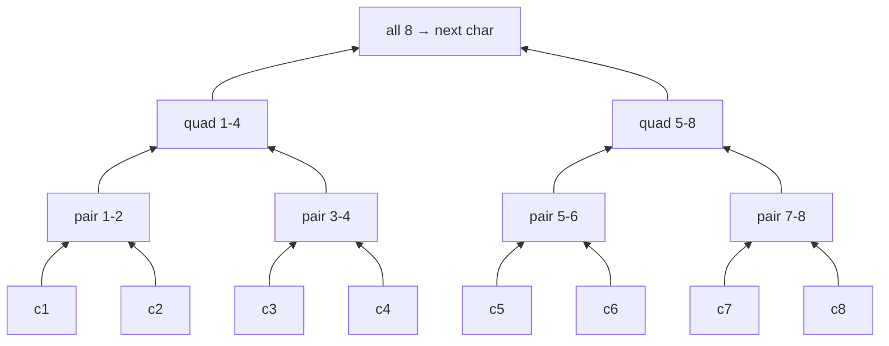

# makemore 5: a WaveNet-style hierarchy

The MLP crushes its whole context into one hidden layer at once. Video 6 follows DeepMind's **WaveNet** (2016): fuse information **gradually**, two neighbours at a time, in a tree. Along the way the code is reorganised into PyTorch-like modules, the step towards writing real `torch.nn` code.



## The key layer: FlattenConsecutive

```python
import torch
from torch import nn

class FlattenConsecutive(nn.Module):
    """Groups n consecutive time steps into one, by concatenating their features."""
    def __init__(self, n):
        super().__init__()
        self.n = n
    def forward(self, x):                      # x: (B, T, C)
        B, T, C = x.shape
        x = x.reshape(B, T // self.n, C * self.n)       # reshape, not view: the input may not be contiguous
        return x.squeeze(1) if x.shape[1] == 1 else x

class BatchNormT(nn.BatchNorm1d):
    """BatchNorm over batch AND time for (B, T, C) inputs, a subtle bug fixed in the video."""
    def forward(self, x):
        return super().forward(x.transpose(1, 2)).transpose(1, 2) if x.dim() == 3 else super().forward(x)

n_embd, n_hidden, vocab, block_size = 24, 128, 27, 8
model = nn.Sequential(
    nn.Embedding(vocab, n_embd),                                            # (B, 8, 24)
    FlattenConsecutive(2), nn.Linear(n_embd * 2, n_hidden, bias=False), BatchNormT(n_hidden), nn.Tanh(),   # (B, 4, 128)
    FlattenConsecutive(2), nn.Linear(n_hidden * 2, n_hidden, bias=False), BatchNormT(n_hidden), nn.Tanh(), # (B, 2, 128)
    FlattenConsecutive(2), nn.Linear(n_hidden * 2, n_hidden, bias=False), BatchNormT(n_hidden), nn.Tanh(), # (B, 128)
    nn.Linear(n_hidden, vocab),
)
x = torch.randint(0, vocab, (4, block_size))
for layer in model:
    x = layer(x)
    print(f"{layer.__class__.__name__:20s} {tuple(x.shape)}")
print(sum(p.numel() for p in model.parameters()), "parameters")
```

Printing the shape after every layer, as here, is how Karpathy finds the bug where BatchNorm averaged over the wrong dimensions: with 3-D inputs, statistics must be computed over both batch and time.

## Results and the bigger picture

With a context of 8 characters and this hierarchy, the video reaches a validation loss just under 2.0, down from about 2.1 for the MLP. In real WaveNet the same idea is implemented with **dilated causal convolutions**, which compute all positions in parallel efficiently; the tree here is the same computation for one output position.

The development style in this video is the lesson as much as the model: build in small, inspectable pieces, check shapes after every layer, keep a table of experiments (context length, width, loss), and only then scale up.

## Optional videos

The lesson above is complete on its own. These go deeper, if you like learning by watching.

**Building makemore Part 5: Building a WaveNet (Andrej Karpathy)**

https://www.youtube.com/watch?v=t3YJ5hKiMQ0
