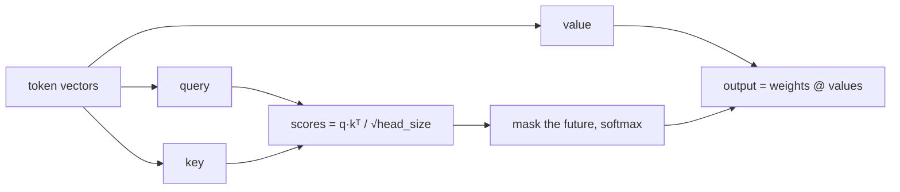

# Let's build GPT 1: from averaging to self-attention

Video 7 builds a GPT on **Tiny Shakespeare** (about 1 MB: all of Shakespeare's works in one text file) and trains it to write fake Shakespeare, character by character. This lesson covers the data and the key derivation of self-attention.

| Resource | Link |
|---|---|
| Code from the video | [github.com/karpathy/ng-video-lecture](https://github.com/karpathy/ng-video-lecture) (`bigram.py`, `gpt.py`) |
| Fuller version | [github.com/karpathy/nanoGPT](https://github.com/karpathy/nanoGPT) |
| Dataset | [tinyshakespeare/input.txt](https://raw.githubusercontent.com/karpathy/char-rnn/master/data/tinyshakespeare/input.txt) |

```python
import os, urllib.request
import torch

if not os.path.exists("input.txt"):
    urllib.request.urlretrieve("https://raw.githubusercontent.com/karpathy/char-rnn/master/data/tinyshakespeare/input.txt", "input.txt")
text = open("input.txt", encoding="utf-8").read()
chars = sorted(set(text))
vocab_size = len(chars)
stoi = {c: i for i, c in enumerate(chars)}
encode = lambda s: [stoi[c] for c in s]
decode = lambda l: "".join(chars[i] for i in l)
print(len(text), "characters,", vocab_size, "unique")
print(encode("hii there"), decode(encode("hii there")))

data = torch.tensor(encode(text), dtype=torch.long)
n = int(0.9 * len(data))
train_data, val_data = data[:n], data[n:]

block_size, batch_size = 8, 4
def get_batch(split):
    d = train_data if split == "train" else val_data
    ix = torch.randint(len(d) - block_size, (batch_size,))
    x = torch.stack([d[i:i + block_size] for i in ix])
    y = torch.stack([d[i + 1:i + block_size + 1] for i in ix])    # targets: the same, shifted by one
    return x, y
xb, yb = get_batch("train")
print(xb.shape, yb.shape)                    # one chunk of 8 holds 8 training examples: each prefix predicts the next char
```

## The mathematical trick: weighted averages with a triangular matrix

Tokens should talk to **previous** tokens only. The simplest way: each token averages the vectors of all tokens up to itself. Doing that with a loop is slow; a lower-triangular matrix does it in one matrix multiply:

```python
torch.manual_seed(1337)
B, T, C = 4, 8, 2
x = torch.randn(B, T, C)

xbow = torch.zeros(B, T, C)                  # version 1: loops
for b in range(B):
    for t in range(T):
        xbow[b, t] = x[b, :t + 1].mean(0)

wei = torch.tril(torch.ones(T, T))           # version 2: matrix multiply
wei = wei / wei.sum(1, keepdim=True)
xbow2 = wei @ x
print(torch.allclose(xbow, xbow2, atol=1e-6))     # equal up to float rounding

tril = torch.tril(torch.ones(T, T))          # version 3: softmax over masked scores (scores are all 0 here)
wei = torch.zeros(T, T).masked_fill(tril == 0, float("-inf")).softmax(dim=-1)
print(torch.allclose(xbow, wei @ x, atol=1e-6))
```

Version 3 is the doorway to attention: the weights are a softmax of **scores** with the future masked out. With all scores zero, it's a plain average. Self-attention makes the scores **data-dependent**.

## Self-attention: one head

```python
torch.manual_seed(1337)
B, T, C, head_size = 4, 8, 32, 16
x = torch.randn(B, T, C)
key = torch.nn.Linear(C, head_size, bias=False)
query = torch.nn.Linear(C, head_size, bias=False)
value = torch.nn.Linear(C, head_size, bias=False)
k, q = key(x), query(x)                                   # what I contain / what I'm looking for
wei = q @ k.transpose(-2, -1) * head_size ** -0.5         # (B, T, T) affinities, scaled
wei = wei.masked_fill(tril == 0, float("-inf")).softmax(dim=-1)
out = wei @ value(x)                                      # aggregate values
print(out.shape, wei[0, -1].detach().round(decimals=2))           # the last token's attention over all 8 positions
```



Karpathy's notes from the video: attention is **communication** between tokens (a directed graph); it has no notion of position, so positions must be added; batches never talk to each other; the √head_size scaling keeps softmax from becoming one-hot at initialisation.

## Optional videos

The lesson above is complete on its own. These go deeper, if you like learning by watching.

**Let's build GPT: from scratch, in code, spelled out (Andrej Karpathy)**

https://www.youtube.com/watch?v=kCc8FmEb1nY
