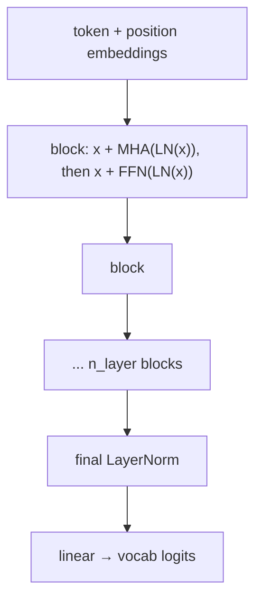

# Let's build GPT 2: the full transformer

From one head to a GPT: multi-head attention, a feed-forward network, residual connections, LayerNorm, dropout, and stacking. This is the video's `gpt.py`, compact. It assumes the data code from the last lesson (`train_data`, `val_data`, `vocab_size`, `decode`).



```python
import torch
import torch.nn as nn
from torch.nn import functional as F

batch_size, block_size = 32, 64            # the video uses 64 and 256 with n_embd 384, 6 heads, 6 layers on a GPU
n_embd, n_head, n_layer, dropout = 64, 4, 4, 0.1
max_iters, eval_interval, lr = 600, 300, 1e-3
torch.manual_seed(1337)

def get_batch(split):
    d = train_data if split == "train" else val_data
    ix = torch.randint(len(d) - block_size, (batch_size,))
    return torch.stack([d[i:i + block_size] for i in ix]), torch.stack([d[i + 1:i + block_size + 1] for i in ix])

class Head(nn.Module):
    def __init__(self, head_size):
        super().__init__()
        self.key, self.query, self.value = (nn.Linear(n_embd, head_size, bias=False) for _ in range(3))
        self.register_buffer("tril", torch.tril(torch.ones(block_size, block_size)))
        self.dropout = nn.Dropout(dropout)
    def forward(self, x):
        B, T, C = x.shape
        k, q = self.key(x), self.query(x)
        wei = (q @ k.transpose(-2, -1) * k.shape[-1] ** -0.5).masked_fill(self.tril[:T, :T] == 0, float("-inf"))
        return self.dropout(F.softmax(wei, dim=-1)) @ self.value(x)

class MultiHeadAttention(nn.Module):
    def __init__(self, num_heads, head_size):
        super().__init__()
        self.heads = nn.ModuleList([Head(head_size) for _ in range(num_heads)])
        self.proj, self.dropout = nn.Linear(n_embd, n_embd), nn.Dropout(dropout)
    def forward(self, x):
        return self.dropout(self.proj(torch.cat([h(x) for h in self.heads], dim=-1)))

class FeedForward(nn.Module):
    def __init__(self):
        super().__init__()
        self.net = nn.Sequential(nn.Linear(n_embd, 4 * n_embd), nn.ReLU(), nn.Linear(4 * n_embd, n_embd), nn.Dropout(dropout))
    def forward(self, x):
        return self.net(x)

class Block(nn.Module):
    def __init__(self):
        super().__init__()
        self.sa, self.ffwd = MultiHeadAttention(n_head, n_embd // n_head), FeedForward()
        self.ln1, self.ln2 = nn.LayerNorm(n_embd), nn.LayerNorm(n_embd)
    def forward(self, x):
        x = x + self.sa(self.ln1(x))           # communicate
        return x + self.ffwd(self.ln2(x))      # compute

class GPTLanguageModel(nn.Module):
    def __init__(self):
        super().__init__()
        self.tok = nn.Embedding(vocab_size, n_embd)
        self.pos = nn.Embedding(block_size, n_embd)
        self.blocks = nn.Sequential(*[Block() for _ in range(n_layer)])
        self.ln_f, self.lm_head = nn.LayerNorm(n_embd), nn.Linear(n_embd, vocab_size)
    def forward(self, idx, targets=None):
        B, T = idx.shape
        x = self.tok(idx) + self.pos(torch.arange(T))
        logits = self.lm_head(self.ln_f(self.blocks(x)))
        loss = None if targets is None else F.cross_entropy(logits.view(B * T, -1), targets.view(B * T))
        return logits, loss
    @torch.no_grad()
    def generate(self, idx, max_new_tokens):
        for _ in range(max_new_tokens):
            logits, _ = self(idx[:, -block_size:])
            idx = torch.cat([idx, torch.multinomial(F.softmax(logits[:, -1], dim=-1), 1)], dim=1)
        return idx

model = GPTLanguageModel()
print(f"{sum(p.numel() for p in model.parameters()) / 1e6:.2f}M parameters")
opt = torch.optim.AdamW(model.parameters(), lr=lr)

@torch.no_grad()
def estimate_loss(iters=20):
    model.eval()
    out = {s: torch.stack([model(*get_batch(s))[1] for _ in range(iters)]).mean().item() for s in ("train", "val")}
    model.train()
    return out

for it in range(max_iters + 1):
    if it % eval_interval == 0:
        print(it, {k: round(v, 3) for k, v in estimate_loss().items()})
    xb, yb = get_batch("train")
    _, loss = model(xb, yb)
    opt.zero_grad(set_to_none=True); loss.backward(); opt.step()

print(decode(model.generate(torch.zeros((1, 1), dtype=torch.long), 200)[0].tolist()))
```

A few hundred steps on a CPU already produce text with Shakespeare's shape (names in capitals, line breaks, short words). In the video, the full-size model (about 10 million parameters, trained on a GPU for about 15 minutes) reaches a validation loss of about 1.48 and produces convincing-looking, meaningless Shakespeare.

## What made the difference, in order

| Change | Why it helps |
|---|---|
| self-attention instead of averaging | tokens choose what to read |
| multiple heads | several kinds of relations at once |
| feed-forward after attention | each token processes what it gathered |
| residual connections | gradients flow straight through deep stacks |
| LayerNorm (pre-norm) | stable activations |
| dropout, then scale up | regularisation lets a bigger model help |

This is a **decoder-only** transformer, the architecture of GPT models. ChatGPT adds pretraining at vast scale plus the fine-tuning stages from the LLM course; nanoGPT is the same code grown up.

## Optional videos

The lesson above is complete on its own. These go deeper, if you like learning by watching.

**Let's build GPT: from scratch, in code, spelled out (Andrej Karpathy)**

https://www.youtube.com/watch?v=kCc8FmEb1nY
