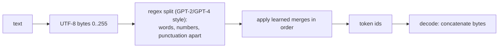

# Let's build the GPT tokenizer

Video 8 opens with a list of LLM weirdness that comes from **tokenization**: struggling to spell or reverse words, worse results in non-English languages, trouble with simple arithmetic, Python indentation costing tokens, odd behaviour on certain strings. To understand them, build the tokenizer.

| Resource | Link |
|---|---|
| Code from the video | [github.com/karpathy/minbpe](https://github.com/karpathy/minbpe) |
| Try tokenizers in the browser | [tiktokenizer.vercel.app](https://tiktokenizer.vercel.app) |

## Bytes, then byte-pair merges

Text is first turned into **UTF-8 bytes** (256 possible values; Arabic letters take 2 bytes each, many emoji 4). Then BPE repeatedly merges the most frequent adjacent pair into a new token id, starting from 256.

```python
def get_stats(ids, counts=None):
    counts = {} if counts is None else counts
    for pair in zip(ids, ids[1:]):
        counts[pair] = counts.get(pair, 0) + 1
    return counts

def merge(ids, pair, idx):
    out, i = [], 0
    while i < len(ids):
        if i < len(ids) - 1 and (ids[i], ids[i + 1]) == pair:
            out.append(idx); i += 2
        else:
            out.append(ids[i]); i += 1
    return out

class BasicTokenizer:
    def train(self, text, vocab_size):
        ids = list(text.encode("utf-8"))
        self.merges = {}
        self.vocab = {i: bytes([i]) for i in range(256)}
        for i in range(vocab_size - 256):
            stats = get_stats(ids)
            pair = max(stats, key=stats.get)                 # most frequent pair
            idx = 256 + i
            ids = merge(ids, pair, idx)
            self.merges[pair] = idx
            self.vocab[idx] = self.vocab[pair[0]] + self.vocab[pair[1]]

    def encode(self, text):
        ids = list(text.encode("utf-8"))
        while len(ids) >= 2:
            stats = get_stats(ids)
            pair = min(stats, key=lambda p: self.merges.get(p, float("inf")))   # earliest-learned merge first
            if pair not in self.merges:
                break
            ids = merge(ids, pair, self.merges[pair])
        return ids

    def decode(self, ids):
        return b"".join(self.vocab[i] for i in ids).decode("utf-8", errors="replace")

text = open("input.txt", encoding="utf-8").read()[:50000]       # Tiny Shakespeare from the GPT lessons
tok = BasicTokenizer()
tok.train(text, vocab_size=256 + 200)
sample = "First Citizen: we are accounted poor citizens."
ids = tok.encode(sample)
print(len(sample.encode("utf-8")), "bytes ->", len(ids), "tokens")
print(tok.decode(ids) == sample)
print([tok.vocab[i].decode("utf-8", errors="replace") for i in ids][:12])
print(len("مرحبا".encode("utf-8")), "bytes for a 5-letter Arabic word, before any merges")
```



## What real tokenizers add

- **A regex pre-split** (GPT-2 and GPT-4 style) so merges never cross word, number and punctuation boundaries; that's minbpe's `RegexTokenizer`.
- **Special tokens** such as `<|endoftext|>` that mark document or turn boundaries and are never produced by merges.
- **Vocabulary size** as a design choice: GPT-2 used about 50,000 tokens, GPT-4's tokenizer about 100,000; bigger vocabularies compress text better but make the embedding table and output layer larger.
- **Training data mix:** a tokenizer trained mostly on English text splits other languages into more, shorter pieces, so they cost more tokens and fit less in the context window. That's one reason multilingual models train tokenizers on multilingual data.

Libraries: OpenAI's **tiktoken** (fast encoding with GPT tokenizers), Google's **SentencePiece** (used by Llama 2 and others, works on Unicode code points with byte fallback), and Hugging Face **tokenizers**.

## Optional videos

The lesson above is complete on its own. These go deeper, if you like learning by watching.

**Let's build the GPT Tokenizer (Andrej Karpathy)**

https://www.youtube.com/watch?v=zduSFxRajkE
