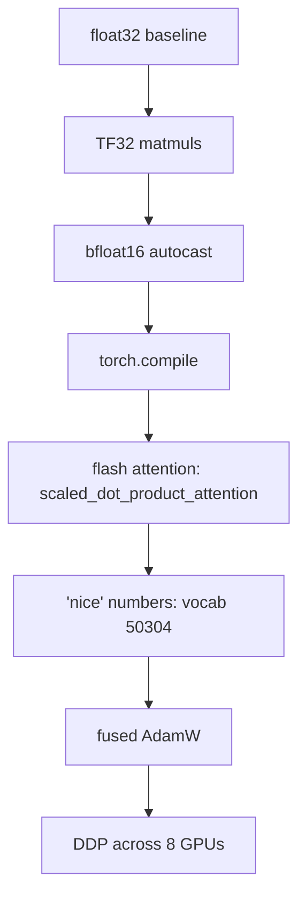

# Let's reproduce GPT-2 (124M), and where to go next

The four-hour video *Let's reproduce GPT-2 (124M)* builds GPT-2's smallest model from scratch and trains it on a real web dataset, applying every speed and stability technique a professional training run uses. The finished code is in **build-nanogpt**, with a git commit for each step of the video.

| Resource | Link |
|---|---|
| Code, step by step | [github.com/karpathy/build-nanogpt](https://github.com/karpathy/build-nanogpt) |
| Dataset | [FineWeb-Edu](https://huggingface.co/datasets/HuggingFaceFW/fineweb-edu) (Hugging Face): educational web pages; the video uses a 10-billion-token sample |
| Evaluation | [HellaSwag](https://github.com/rowanz/hellaswag): choosing the sensible ending of a sentence |
| Faster C/CUDA version | [github.com/karpathy/llm.c](https://github.com/karpathy/llm.c) |
| A full ChatGPT-like pipeline | [github.com/karpathy/nanochat](https://github.com/karpathy/nanochat) (tokenizer, pretraining, fine-tuning, chat UI) |

## The model: GPT-2 124M

```python
from dataclasses import dataclass

@dataclass
class GPTConfig:
    block_size: int = 1024     # context length
    vocab_size: int = 50257    # GPT-2's tokenizer; the video pads it to 50304 (a "nicer" number, faster on GPUs)
    n_layer: int = 12
    n_head: int = 12
    n_embd: int = 768

c = GPTConfig()
per_block = 12 * c.n_embd ** 2 + 13 * c.n_embd                 # attention + MLP weights, biases and LayerNorms
total = c.n_layer * per_block + c.vocab_size * c.n_embd + c.block_size * c.n_embd + 2 * c.n_embd
print(f"{total / 1e6:.1f}M parameters")                         # about 124M, with the output layer tied to the token embedding
```

The first part of the video loads OpenAI's released GPT-2 weights from Hugging Face into this exact structure to prove the architecture matches, then trains it from random weights.

## The speed-ups, in the order of the video



Each step is measured in **tokens per second**; together they make training roughly an order of magnitude faster than the first version. Every one of them is covered in the PyTorch 2 and 3 courses in this library.

## The training recipe (from the GPT-3 paper's settings)

| Setting | Value in the video |
|---|---|
| batch size | about 0.5 million tokens per step, reached with gradient accumulation |
| optimizer | AdamW, betas (0.9, 0.95), weight decay 0.1 on matrices only |
| learning rate | max 6e-4, linear warmup, then cosine decay to 10% |
| gradient clipping | global norm 1.0 |
| data | FineWeb-Edu, pre-tokenised into shards |
| evaluation | validation loss, HellaSwag accuracy, and samples, every few hundred steps |

```python
import math

max_lr, min_lr, warmup_steps, max_steps = 6e-4, 6e-5, 715, 19073
def get_lr(it):
    if it < warmup_steps:
        return max_lr * (it + 1) / warmup_steps
    if it > max_steps:
        return min_lr
    ratio = (it - warmup_steps) / (max_steps - warmup_steps)
    return min_lr + 0.5 * (1.0 + math.cos(math.pi * ratio)) * (max_lr - min_lr)
print([f"{get_lr(s):.2e}" for s in (0, 714, 10000, 19073)])
print(f"{19073 * 2 ** 19 / 1e9:.1f}B tokens: one pass over the 10B-token sample")
```

The result: trained on a rented machine with 8 GPUs for a few hours, the model reaches GPT-2 124M's HellaSwag score using far fewer training tokens than the original, largely thanks to better data. It's the clearest demonstration available of how a modern LLM pretraining run works end to end.

## Where to go next

1. Re-type nanoGPT yourself and train it on a dataset you care about (Arabic text, your own notes, code).
2. Watch *Intro to Large Language Models* and *Deep Dive into LLMs like ChatGPT* for the big picture of post-training (SFT, RLHF, reasoning), then the LLM course in this library.
3. Explore **nanochat** to see the whole pipeline from tokenizer to chat interface in one small repository.

## Optional videos

The lesson above is complete on its own. These go deeper, if you like learning by watching.

**Let's reproduce GPT-2 (124M) (Andrej Karpathy)**

https://www.youtube.com/watch?v=l8pRSuU81PU

**Intro to Large Language Models (Andrej Karpathy, 1 hour)**

https://www.youtube.com/watch?v=zjkBMFhNj_g

**Deep Dive into LLMs like ChatGPT (Andrej Karpathy, 3.5 hours)**

https://www.youtube.com/watch?v=7xTGNNLPyMI
