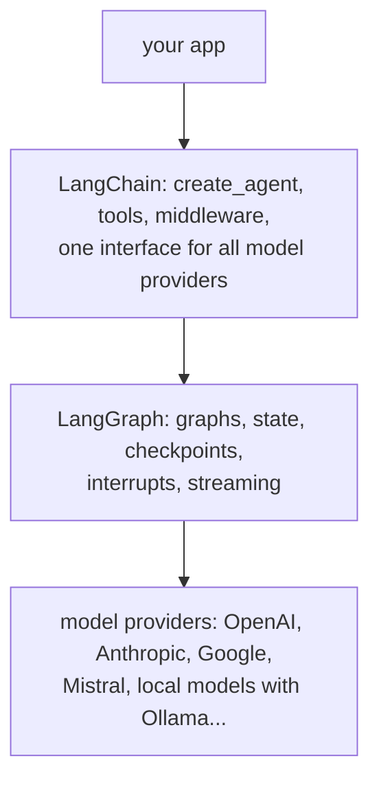

# What LangChain and LangGraph are, and your first model call

**LangChain** is an open-source Python (and JavaScript) library for building apps on top of language models. It gives you one interface for many model providers, a standard way to define tools, and a ready-made **agent**: a model that calls tools in a loop until a task is done. **LangGraph** is the lower-level runtime underneath: it runs any workflow as a graph of steps with saved state, so a task can pause for a human, resume after a crash, or branch.



## Version 1 changed a lot

LangChain 1.0 came out in October 2025, together with LangGraph 1.0. It rebuilt the library around one function, `create_agent`, and moved the older classes (chains like `LLMChain`, the old retrievers and the hub) to a separate package, `langchain-classic`. **Most tutorials and answers online from before late 2025 use the old API.** This course teaches only v1. When you see `from langchain.chains import ...` or `initialize_agent(...)`, you're looking at old code.

## Install

```bash
python -m venv .venv && source .venv/bin/activate     # Windows: .venv\Scripts\activate
pip install -U langchain langgraph
pip install -U langchain-ollama       # for free local models; or langchain-openai, langchain-anthropic...
```

Each provider has its own small package. To run everything on your own computer for free, install [Ollama](https://ollama.com/) and pull a model that supports tool calling, for example `ollama pull qwen3`. With a hosted provider, set its API key as an environment variable (for example `OPENAI_API_KEY`) instead.

## Your first call

```python
from langchain.chat_models import init_chat_model

model = init_chat_model("ollama:qwen3", temperature=0)   # "provider:model-name"
reply = model.invoke("In one sentence, what is a vector database?")
print(reply.content)
```

`init_chat_model` takes a `"provider:model"` string, so switching from a local model to a hosted one is a one-line change. The reply is an `AIMessage`: `.content` holds the text, and other fields hold token usage and, later, tool calls.

## Messages

Chat models take a list of messages with roles:

```python
from langchain.messages import SystemMessage, HumanMessage

messages = [
    SystemMessage("You answer in plain English, in at most two sentences."),
    HumanMessage("Why do LLMs sometimes make things up?"),
]
reply = model.invoke(messages)
print(reply.content)
```

You can also pass plain dictionaries like `{"role": "user", "content": "..."}`. Newer models can return several kinds of content in one reply (text, reasoning, images, tool calls); v1 gives every message a standard `.content_blocks` list so your code reads them the same way for every provider.

## Optional videos

The lesson above is complete on its own. These go deeper, if you like learning by watching.

**LangChain Full Crash Course: AI Agents in Python (NeuralNine)**

https://www.youtube.com/watch?v=J7j5tCB_y4w
