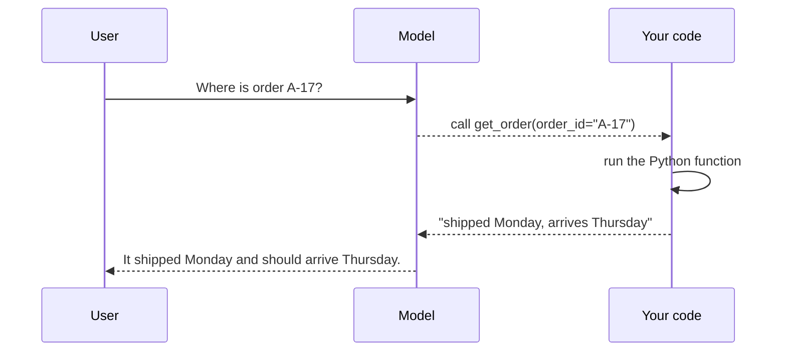

# Tools: let the model ask your code to act

A **tool** is a function the model may ask you to run. The model never runs code: it returns the tool's name and arguments, your program runs it, and the result goes back to the model.



## Define a tool

```python
from langchain.tools import tool

@tool
def get_order(order_id: str) -> str:
    """Look up an order's status by its id, for example A-17."""
    orders = {"A-17": "shipped on Monday, arrives Thursday"}
    return orders.get(order_id, "no such order")

print(get_order.name)                       # get_order
print(get_order.args)                       # {'order_id': {'title': 'Order Id', 'type': 'string'}}
print(get_order.invoke({"order_id": "A-17"}))
```

The `@tool` decorator reads three things, and the model sees all of them:

- the **function name** becomes the tool name;
- the **type hints** become a JSON schema for the arguments;
- the **docstring** becomes the description.

So the docstring is a prompt. Say what the tool does, when to use it, and what the arguments look like. A vague description ("gets data") is the most common reason a model picks the wrong tool or invents arguments.

## Good tools

| Do | Why |
|---|---|
| One clear job per tool | the model chooses better between few, distinct tools |
| Simple argument types (`str`, `int`, `Literal[...]`) | fewer malformed calls |
| Return short, useful text | tool results fill the context window |
| Return a clear error message instead of raising | the model can read it and try again |
| Read-only by default | a confused model can't do damage |

## Let the model choose

```python
model_with_tools = model.bind_tools([get_order])
msg = model_with_tools.invoke("Is order A-17 on its way?")
print(msg.tool_calls)   # [{'name': 'get_order', 'args': {'order_id': 'A-17'}, 'id': '...'}]
```

`bind_tools` only tells the model which tools exist. Running them and sending results back in a loop is the agent's job, which the next module hands to `create_agent`.
