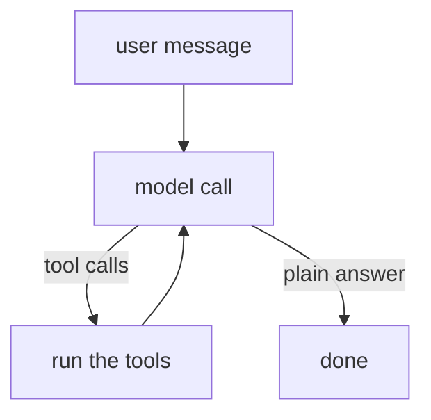

# Your first agent with create_agent

An **agent** is a loop: call the model; if it asks for tools, run them and add the results to the conversation; call the model again; stop when it answers without asking for a tool.



`create_agent` builds that loop for you on top of LangGraph.

```python
from langchain.agents import create_agent

agent = create_agent(
    model,                         # a model object, or a string like "ollama:qwen3"
    tools=[get_order],
    system_prompt="You are a support assistant for an online shop. "
                  "Use tools to check facts; never guess an order status.",
)
result = agent.invoke({"messages": [{"role": "user", "content": "Where is my order A-17?"}]})
for m in result["messages"]:
    print(type(m).__name__, m.content or m.tool_calls)
```

The result is the agent's **state**: a dictionary whose `"messages"` list holds the whole run. Printing it shows the loop at work: your message, the model's tool call, the tool's result (a `ToolMessage`), and the final answer.

## Streaming

Users shouldn't stare at a blank screen while the agent works. `stream` returns progress as it happens:

```python
for update in agent.stream(
    {"messages": [{"role": "user", "content": "Where is order A-17?"}]},
    stream_mode="updates",
):
    for step, data in update.items():
        print(step, "->", data["messages"][-1].content or data["messages"][-1].tool_calls)
```

Each update names the step that just finished (`model` or `tools`). Use `stream_mode="messages"` to receive the answer token by token for a chat interface.

## When the loop goes wrong

- **It never stops:** set a step budget (module 3 shows `ModelCallLimitMiddleware`), and LangGraph also stops runaway graphs with a recursion limit.
- **It calls the wrong tool:** improve tool names and descriptions before touching the system prompt.
- **It guesses instead of calling a tool:** say in the system prompt *when* to use tools, and test that case.

## Optional videos

The lesson above is complete on its own. These go deeper, if you like learning by watching.

**How We Build Effective Agents (Barry Zhang, Anthropic, AI Engineer)**

https://www.youtube.com/watch?v=D7_ipDqhtwk
