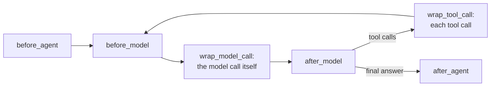

# Middleware: control without rewriting the loop

Real agents need rules around the loop: hide personal data, stop runaway costs, ask a human before risky actions. In v1 these are **middleware**: pieces that run at fixed points of every agent run.



## Built-in middleware worth knowing

| Middleware | What it does |
|---|---|
| `PIIMiddleware("email", strategy="redact")` | finds emails (or credit cards, IPs, your own patterns) and redacts, masks, hashes or blocks them |
| `SummarizationMiddleware(model, trigger=("tokens", 4000))` | when history grows too long, replaces old messages with a summary |
| `HumanInTheLoopMiddleware(interrupt_on={...})` | pauses before chosen tools until a person approves, edits or rejects |
| `ModelCallLimitMiddleware(run_limit=10)` | caps model calls per run, so a loop can't burn your budget |
| `ToolCallLimitMiddleware`, `ToolRetryMiddleware`, `ModelFallbackMiddleware` | cap tool calls, retry failing tools, switch to a backup model on errors |

```python
from langchain.agents.middleware import PIIMiddleware, ModelCallLimitMiddleware

safe_agent = create_agent(
    model,
    tools=[get_order],
    middleware=[
        PIIMiddleware("email", strategy="redact"),
        ModelCallLimitMiddleware(run_limit=8),
    ],
)
```

## Human approval

```python
from langchain.agents.middleware import HumanInTheLoopMiddleware
from langgraph.checkpoint.memory import InMemorySaver
from langgraph.types import Command

@tool
def refund(order_id: str, amount: float) -> str:
    """Refund an amount in dollars for an order. Needs approval."""
    return f"refunded ${amount} on {order_id}"

approval_agent = create_agent(
    model,
    tools=[get_order, refund],
    middleware=[HumanInTheLoopMiddleware(interrupt_on={"refund": True})],
    checkpointer=InMemorySaver(),          # pausing needs saved state
)
config = {"configurable": {"thread_id": "ticket-42"}}
result = approval_agent.invoke({"messages": [{"role": "user", "content": "Refund $20 on A-17"}]}, config)
print(result["__interrupt__"][0].value["action_requests"])   # what is waiting for approval

result = approval_agent.invoke(Command(resume={"decisions": [{"type": "approve"}]}), config)
print(result["messages"][-1].content)
```

The first `invoke` stops before `refund` runs and returns an interrupt describing the request. Your app shows it to a person; their decision (`approve`, `edit`, `reject`) goes back with `Command(resume=...)` and the same `thread_id`. The pause can last seconds or days, because the state is saved by the checkpointer (in production, a database-backed one instead of `InMemorySaver`).
