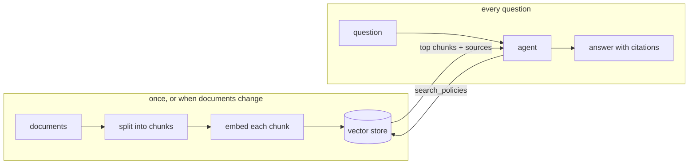

# RAG: an agent that answers from your documents

**Retrieval-augmented generation** gives the model your documents at question time, so answers are current and can cite sources. In v1 the cleanest way is to make retrieval a **tool**: the agent decides when to search, can search again with better words, and cites what it found.



## Index the documents

```python
from langchain.embeddings import init_embeddings
from langchain_core.documents import Document
from langchain_core.vectorstores import InMemoryVectorStore
from langchain_text_splitters import RecursiveCharacterTextSplitter

embeddings = init_embeddings("ollama:nomic-embed-text")   # pip install langchain-text-splitters; ollama pull nomic-embed-text

docs = [
    Document(page_content="Refunds are paid within 14 days of approval. Shipping fees are not refunded.",
             metadata={"source": "refunds.md"}),
    Document(page_content="Standard shipping takes 3 to 5 working days inside Egypt.",
             metadata={"source": "shipping.md"}),
]
splitter = RecursiveCharacterTextSplitter(chunk_size=500, chunk_overlap=50)
chunks = splitter.split_documents(docs)

store = InMemoryVectorStore(embeddings)
store.add_documents(chunks)
```

For real files, LangChain's document loaders read PDFs, web pages and more into `Document` objects, and you'd swap `InMemoryVectorStore` for a persistent one (pgvector, Qdrant, Chroma...) with the same methods.

## Retrieval as a tool

```python
@tool(response_format="content_and_artifact")
def search_policies(query: str):
    """Search the shop's support policies. Use it for any question about refunds or shipping."""
    found = store.similarity_search(query, k=2)
    text = "\n\n".join(f"[{d.metadata['source']}] {d.page_content}" for d in found)
    return text, found          # text for the model, documents kept for your app

rag_agent = create_agent(
    model,
    tools=[search_policies],
    system_prompt="Answer only from the policies you find, and cite the [source] of each fact. "
                  "If the policies don't say, answer that you don't know.",
)
result = rag_agent.invoke({"messages": [{"role": "user", "content": "How long do refunds take?"}]})
print(result["messages"][-1].content)
```

`response_format="content_and_artifact"` sends the text to the model and keeps the raw documents on the `ToolMessage` (`.artifact`), so your interface can show source links without parsing the answer.

## Then measure it

A RAG agent is only as good as its retrieval. Write 20 or more real questions with the source that should answer each, and measure how often that source is in the results (hit rate), before you tune prompts. The *Get hired as an AI engineer* series builds and measures a full RAG project this way.

## Optional videos

The lesson above is complete on its own. These go deeper, if you like learning by watching.

**What is Retrieval-Augmented Generation (RAG)? (IBM Technology)**

https://www.youtube.com/watch?v=T-D1OfcDW1M
