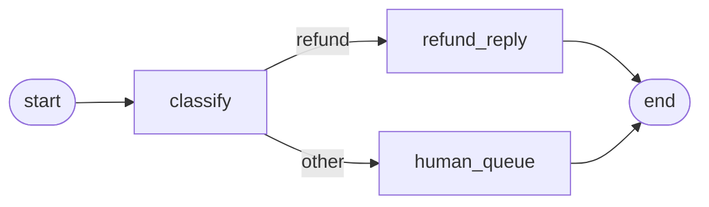

# LangGraph: your own workflows as graphs

`create_agent` is one particular graph: model, tools, repeat. When your process has a fixed shape (classify, then route, then maybe ask a human), build the graph yourself with LangGraph. Anthropic's guide *Building effective agents* calls these **workflows**: your code fixes the path, and the model fills in steps. They're cheaper, faster and easier to test than open-ended agents.

## Three ideas

- **State:** a typed dictionary every step reads and updates.
- **Nodes:** functions that take the state and return the fields they change.
- **Edges:** which node runs next; **conditional edges** choose with a function.

```python
from typing import TypedDict, Literal
from langgraph.graph import StateGraph, START, END

class State(TypedDict):
    ticket: str
    category: str
    reply: str

def classify(state: State) -> dict:
    # in a real app: a model call with structured output
    return {"category": "refund" if "refund" in state["ticket"].lower() else "other"}

def refund_reply(state: State) -> dict:
    return {"reply": "Refunds are paid within 14 days of approval."}

def human_queue(state: State) -> dict:
    return {"reply": "A teammate will answer you today."}

def route(state: State) -> Literal["refund_reply", "human_queue"]:
    return "refund_reply" if state["category"] == "refund" else "human_queue"

graph = StateGraph(State)
graph.add_node("classify", classify)
graph.add_node("refund_reply", refund_reply)
graph.add_node("human_queue", human_queue)
graph.add_edge(START, "classify")
graph.add_conditional_edges("classify", route)
graph.add_edge("refund_reply", END)
graph.add_edge("human_queue", END)
app = graph.compile()

print(app.invoke({"ticket": "Where is my refund?"}))
print(app.get_graph().draw_mermaid())       # a diagram of your graph
```



## Graphs and agents together

A node can be anything, including a whole agent from `create_agent`. A common design: a cheap classification node routes easy tickets to fixed replies and only hard ones to an agent with tools. Compile with a checkpointer (`graph.compile(checkpointer=...)`) to get the same pause, resume and memory as before, and call `interrupt(...)` inside a node to wait for a person.
