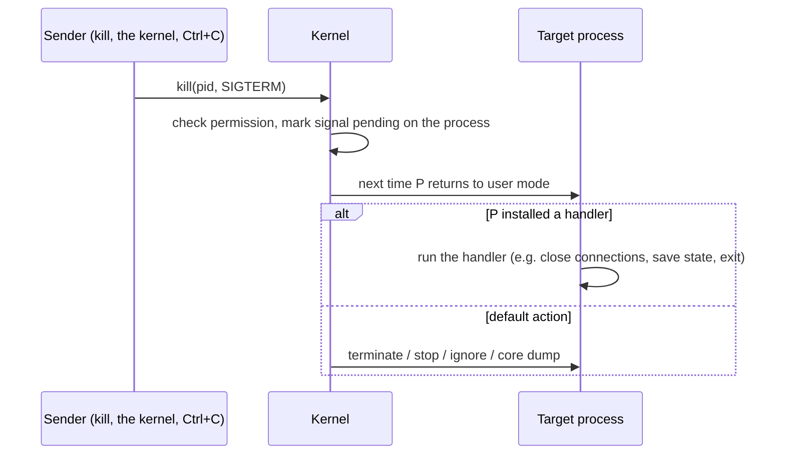

# Signals in depth

A signal is the kernel interrupting a process with a small numbered message. You met `kill` in Linux Fundamentals; here's what actually happens.



## Default actions

| Signal | Default | Can be caught? | Typical use |
|---|---|---|---|
| SIGTERM (15) | Terminate | Yes | "Please shut down" (systemd, Docker, `kill`) |
| SIGINT (2) | Terminate | Yes | Ctrl+C |
| SIGHUP (1) | Terminate | Yes | Daemons reload config |
| SIGKILL (9) | Terminate | **No** | Last resort |
| SIGSTOP (19) | Stop | **No** | Pause |
| SIGSEGV (11) | Core dump | Yes (rarely wise) | Bad memory access |
| SIGCHLD (17) | Ignore | Yes | A child exited |
| SIGPIPE (13) | Terminate | Yes | Writing to a pipe nobody reads (`yes | head`) |
| SIGUSR1/2 | Terminate | Yes | App-defined (nginx: reopen logs) |

## Why kill -9 is not the normal way

- No cleanup: temp files, lock files and half-written data stay behind.
- Children may be orphaned, connections dropped mid-request.
- Database or queue state may need recovery on next start.

The graceful sequence (what systemd and Docker do): **SIGTERM, wait (default 90 s / 10 s), then SIGKILL**.

## When even SIGKILL doesn't work

A process in state **D** (uninterruptible sleep) is waiting inside the kernel, usually for disk or NFS I/O. Signals are delivered only when it returns to user mode, so `kill -9` waits too. Fix the I/O (a hung NFS server, a dying disk); `cat /proc/PID/stack` shows where it's stuck.

## Zombies and orphans

- **Zombie** (`Z`): exited, parent hasn't called `wait()`. Uses no memory, only a PID. Many zombies = a buggy parent. Kill or fix the **parent**; when it dies, PID 1 adopts and reaps them.
- **Orphan**: parent died first; PID 1 (or a "subreaper") adopts it. That's normal.
- In containers, your app may be PID 1. If it doesn't reap children, zombies pile up; that's why `docker run --init` / `tini` exist.

```bash
ps -eo pid,ppid,stat,comm | awk '$3 ~ /Z/'   # zombies and their parents
trap 'echo got TERM; exit 0' TERM            # a handler in bash
kill -l                                       # list all signals
```
