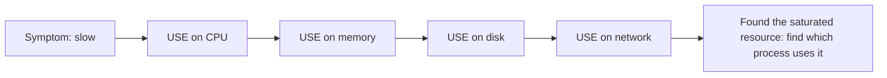

# Performance: the USE method and the 60-second check

Brendan Gregg's **USE method**: for every resource, check

- **U**tilization: how busy it is,
- **S**aturation: how much work is waiting for it,
- **E**rrors: is anything failing?

| Resource | Utilization | Saturation | Errors |
|---|---|---|---|
| CPU | `mpstat -P ALL 1`, `top` | Load > CPUs, `vmstat` r column, PSI cpu | `dmesg` (machine checks) |
| Memory | `free -h` | Swapping (`vmstat` si/so), PSI memory, OOM kills | `dmesg` OOM messages |
| Disk | `iostat -xz 1` %util | `iostat` aqu-sz, wait times; PSI io | `dmesg`, `smartctl` |
| Network | `sar -n DEV 1`, `ip -s link` | Drops, retransmits (`nstat`, `ss -ti`) | `ip -s link` errors |

## Gregg's 60-second checklist

```bash
uptime                 # load trend: rising or falling?
dmesg -T | tail        # OOM kills, errors
vmstat 1 5             # r, si/so, us/sy/id/wa
mpstat -P ALL 1 3      # one CPU at 100%? (a single-threaded bottleneck)
pidstat 1 3            # which processes use CPU
iostat -xz 1 3         # disk busy and waits
free -h                # memory and cache
sar -n DEV 1 3         # network throughput per interface
sar -n TCP,ETCP 1 3    # new connections, retransmits
top                    # confirm the big picture
```

Most of these come from the `sysstat` package.

## Pressure stall information (PSI)

Since kernel 4.20, Linux tells you directly how much time tasks **lost** waiting for a resource:

```bash
cat /proc/pressure/cpu
cat /proc/pressure/memory
cat /proc/pressure/io
# some avg10=4.12 avg60=2.03 avg300=0.80 total=...
#   some: at least one task was stalled this % of the time
#   full: ALL tasks were stalled (memory/io)
```

PSI is a cleaner saturation signal than load average (which mixes CPU and disk waits). Tools like `systemd-oomd` act on it.

## A method beats a tool list



Check every resource in order instead of jumping to the one you suspect; the surprise is usually in the one you skipped.

## Optional videos

The lesson above is complete on its own. These go deeper, if you like learning by watching.

**Brendan Gregg, Linux Systems Performance (USENIX LISA 2019)**

https://www.youtube.com/watch?v=fhBHvsi0Ql0
