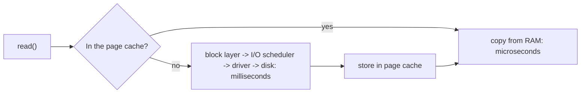

# I/O: the page cache, writeback and disk bottlenecks

## Reads



That's why the second run of anything is faster, and why "free" memory on a healthy server is small: the kernel uses spare RAM as cache.

```bash
sync; echo 3 | sudo tee /proc/sys/vm/drop_caches   # TEST machines only: empty the cache to measure cold reads
```

## Writes and writeback

`write()` usually returns once data is in the page cache (now **dirty**). Kernel flusher threads write it out later, when:

- it's older than `vm.dirty_expire_centisecs` (30 s default), or
- dirty data exceeds `vm.dirty_background_ratio` (background writeback starts), or
- it exceeds `vm.dirty_ratio`: now the **writing process itself is blocked** until data reaches disk.

That last one explains sudden multi-second stalls when copying big files on machines with lots of RAM.

`fsync(fd)` forces one file to disk; `O_DIRECT` skips the cache (databases that manage their own cache use it).

## Finding the I/O hog

```bash
iostat -xz 1         # per device: r/s w/s, await (ms per request), aqu-sz (queue), %util
sudo iotop -o        # processes doing I/O right now
pidstat -d 1         # read/write per process
cat /proc/pressure/io
```

| `iostat` shows | Means |
|---|---|
| High `%util`, high `await` | The disk is saturated |
| High `await`, low `%util` | Slow device or slow network storage |
| Many tiny writes | Something calls `fsync` constantly (logs, a chatty database) |

On cloud disks, check your **IOPS / throughput limits**: a "slow disk" is often a disk at its paid limit.

## Mount options that matter

| Option | Effect |
|---|---|
| `noatime` | Don't write access times on every read (less I/O; `relatime` is the default compromise) |
| `discard` / periodic `fstrim` | Tell the SSD which blocks are free |
| `ro` | Read-only; the kernel switches to this itself after serious file system errors |
