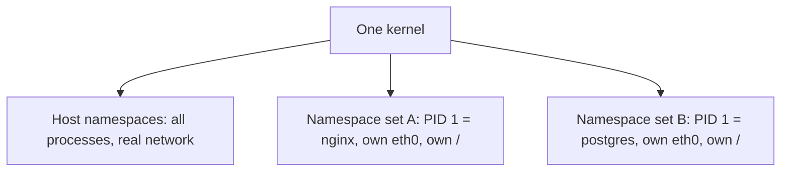

# Namespaces: giving a process its own view

A **namespace** wraps a global resource so that processes inside see their own private copy. Containers are, at heart, normal processes in a set of namespaces.

| Namespace | Isolates | Inside you see |
|---|---|---|
| **mnt** | Mount points | Your own file system tree |
| **pid** | Process IDs | Yourself as PID 1, only your processes |
| **net** | Network stack | Your own interfaces, routes, ports, firewall |
| **uts** | Hostname | Your own hostname |
| **ipc** | Shared memory, message queues | Your own |
| **user** | User and group IDs | Root inside, an ordinary user outside |
| **cgroup** | The cgroup tree | Your cgroup as the root |
| **time** | Some clocks | Your own uptime offset |



## Try it with unshare

```bash
sudo unshare --uts --pid --fork --mount-proc bash
hostname sandbox          # only changes the hostname inside
hostname
ps aux                    # only bash and ps: you're PID 1
exit
hostname                  # the host's name is untouched
```

A private network namespace starts with only a downed loopback:

```bash
sudo unshare --net bash
ip a                      # just lo, DOWN: no network at all
exit
```

## Seeing and entering namespaces

```bash
lsns                          # namespaces on the system and their first process
ls -l /proc/$$/ns             # the namespaces of your shell (inode numbers)
sudo nsenter -t PID -n ss -tlnp   # run ss inside another process's network namespace
sudo nsenter -t PID -a bash       # enter all its namespaces (how 'docker exec' works)
```

`nsenter -n` is a superb debugging trick: use the **host's** tools inside a container's network, even if the container image has no `ss` or `curl`.

## What namespaces don't do

They change what a process **sees**, not how much it can **use**. A process in its own namespaces can still eat all the CPU and memory. That's what cgroups (Day 6) are for.

## Optional videos

The lesson above is complete on its own. These go deeper, if you like learning by watching.

**Michael Kerrisk, Containers unplugged: Linux namespaces (NDC TechTown 2019)**

https://www.youtube.com/watch?v=0kJPa-1FuoI
