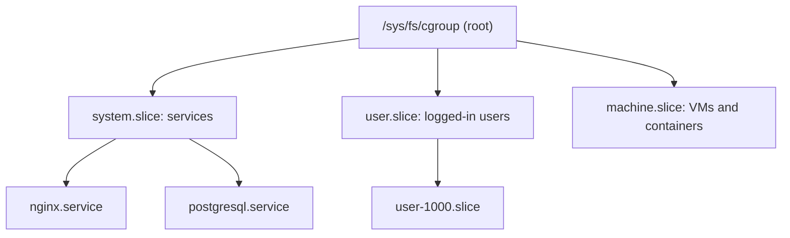

# cgroups v2: limiting what a process can use

**Control groups** put processes in a tree and limit, account for and prioritize the resources each branch uses. Modern distributions use **cgroup v2**: one unified tree at `/sys/fs/cgroup`.



systemd owns this tree: every service is its own cgroup, which is how systemd knows every process a service started, even forked children.

## Look at it

```bash
systemd-cgls | head -40              # the tree with processes
systemd-cgtop                        # live CPU, memory, I/O per cgroup
cat /proc/$$/cgroup                  # which cgroup your shell is in
ls /sys/fs/cgroup/system.slice/nginx.service/
cat /sys/fs/cgroup/system.slice/nginx.service/memory.current
```

## The main controls

| File | Means |
|---|---|
| `memory.max` | Hard limit; above it, reclaim, then OOM-kill inside this cgroup only |
| `memory.high` | Soft limit; above it the group is throttled and reclaimed hard |
| `cpu.max` | `quota period`: `50000 100000` = half of one CPU |
| `cpu.weight` | Relative share when CPUs are contended (default 100) |
| `io.max` | Bytes or IOPS per second per device |
| `pids.max` | Maximum processes (stops fork bombs) |

## Use them through systemd

```bash
sudo systemctl set-property nginx.service MemoryMax=512M CPUQuota=150%
systemd-run --scope -p MemoryMax=200M -p CPUQuota=50% stress-ng --vm 1 --vm-bytes 400M
```

In a unit file:

```ini
[Service]
MemoryHigh=400M
MemoryMax=512M
CPUQuota=150%
TasksMax=200
IOWeight=50
```

## Why this matters

- One runaway service can't take the whole server with it.
- Docker's `--memory` and `--cpus`, and Kubernetes' resource limits, are exactly these files.
- `memory.events` in a cgroup's folder counts how often it hit its limit and how many OOM kills happened: the first place to look when a container "randomly restarts".

## Optional videos

The lesson above is complete on its own. These go deeper, if you like learning by watching.

**Michael Kerrisk, An introduction to control groups (cgroups) version 2**

https://www.youtube.com/watch?v=kcnFQgg9ToY

**Michael Kerrisk, Diving deeper into control groups (cgroups) v2**

https://www.youtube.com/watch?v=Clr_MQwaJtA
