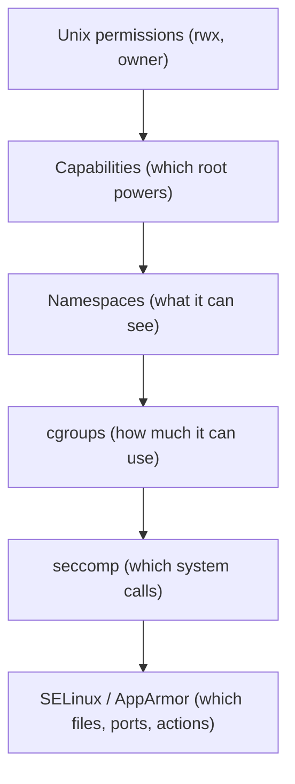

# seccomp, SELinux and AppArmor

## seccomp: limit which system calls a process may make

The kernel exposes about 450 system calls. A web server needs a few dozen. **seccomp** lets a process install a filter (a tiny BPF program) that the kernel checks on every system call: allow, return an error, or kill.

- Docker applies a default seccomp profile that blocks around 50 dangerous calls (like `mount`, `kexec_load`, `bpf`).
- systemd's `SystemCallFilter=@system-service` uses groups of calls.
- Chrome, Firefox and OpenSSH sandbox themselves with it.

```bash
grep Seccomp /proc/$$/status            # 0 = none, 2 = filter active
docker run --rm alpine grep Seccomp /proc/1/status   # 2: Docker's profile
```

## Mandatory access control (MAC)

Normal Unix permissions are **discretionary**: a file's owner decides. MAC adds rules that even root processes can't override, written per program.

| | SELinux | AppArmor |
|---|---|---|
| Default on | Red Hat, Fedora, Rocky, Alma, Android | Ubuntu, Debian, SUSE |
| Rules attach to | Labels on every file and process | Paths, per program profile |
| Status | `getenforce`, `sestatus` | `sudo aa-status` |
| Investigate denials | `sudo ausearch -m avc -ts recent`, `audit2why` | `journalctl -k | grep apparmor` |

```bash
ls -Z /var/www/html            # SELinux labels
ps -eZ | grep nginx
```

## The SELinux trap everyone hits

You put website files in `/srv/www`, permissions are perfect, and nginx gets "Permission denied". The files have the wrong **label**:

```bash
sudo semanage fcontext -a -t httpd_sys_content_t '/srv/www(/.*)?'
sudo restorecon -Rv /srv/www
```

**Don't** turn SELinux off (`setenforce 0`) to make it work. Read the denial, fix the label or boolean (`getsebool -a | grep httpd`, `setsebool -P httpd_can_network_connect on`).

## Layers



Containers use all six. A good systemd unit can use all six too.

## Optional videos

The lesson above is complete on its own. These go deeper, if you like learning by watching.

**Michael Kerrisk, Using seccomp to limit the Linux kernel attack surface (NDC Security 2023)**

https://www.youtube.com/watch?v=RT0PWBWp8wc
