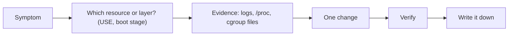

# Capstone: incident drills

Run each drill on a test VM. For each: **break it** (the setup command), then diagnose from the symptom alone, as if a colleague called you. Write down what you checked, in what order, and what you found.

## Drill 1: the slow server

Setup: `stress-ng --io 4 --hdd 2 --timeout 600 &`

Symptom: "Everything is slow, but top shows the CPU mostly idle."
Expect to use: `uptime`, `vmstat` (wa), `iostat -xz`, `iotop`, `/proc/pressure/io`.

## Drill 2: the service that keeps dying

Setup: give a test service `MemoryMax=50M` and make it allocate 200 MB.

Symptom: "It restarts every few minutes, the app log shows nothing."
Expect to use: `systemctl status`, `journalctl -u`, `memory.events` in its cgroup folder, `journalctl -k | grep -i oom`.

## Drill 3: the disk that's full but isn't

Setup: `python3 -c "f=open('/var/tmp/big','wb'); f.write(b'0'*2_000_000_000); import time; time.sleep(3600)" &` then `rm /var/tmp/big`.

Symptom: "df says 2 GB used that du can't find."
Expect to use: `df -h`, `du`, `lsof +L1`.

## Drill 4: works for me, not for the service

Setup: a unit with `ProtectHome=yes` that reads a file in `/home`.

Symptom: "The script runs fine by hand but fails as a service with No such file or directory."
Expect to use: `journalctl -u`, `systemctl show -p ProtectHome`, `nsenter -t PID -m ls /home`.

## Drill 5: the port nobody can reach

Setup: in a network namespace or container, a server bound to `127.0.0.1`.

Symptom: "Health checks fail from outside."
Expect to use: `ss -tlnp`, `nsenter -t PID -n ss -tlnp`, `curl -v`.

## Drill 6: emergency mode after reboot

Setup: add a bogus line to `/etc/fstab` (`UUID=0000 /data ext4 defaults 0 2`), take a snapshot first, reboot.

Symptom: "The server won't boot."
Expect to use: the emergency shell routine from the last lesson.

## The habit you're building

