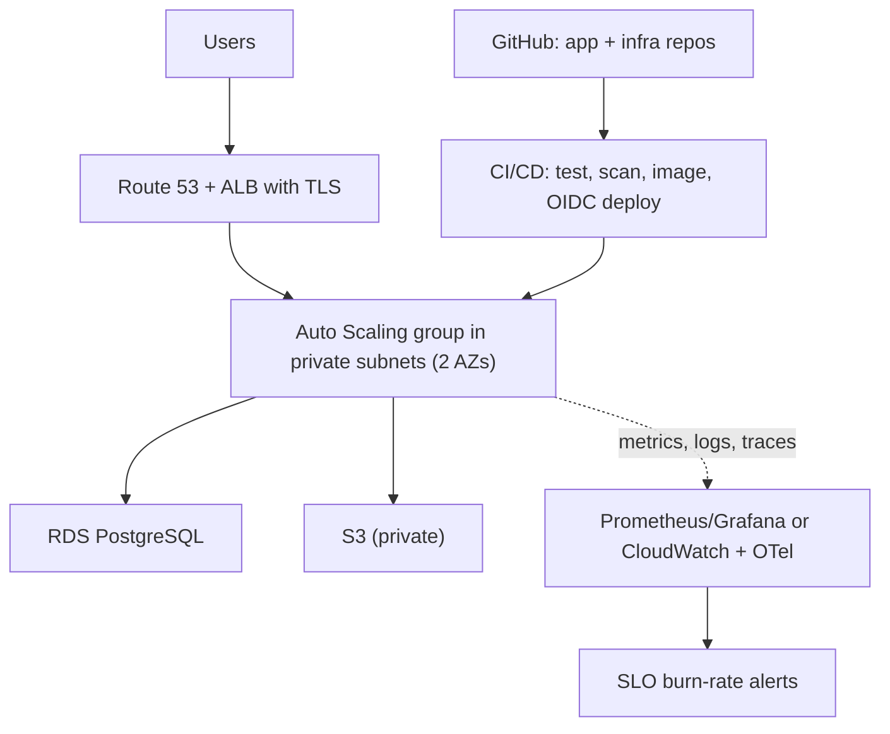

# The final project: what you'll build

This course is one project that uses the whole track, from Linux fundamentals to observability. When you finish, you'll have a portfolio piece you can show in any cloud, DevOps or SRE interview.

## The system

A small but real web service (a link shortener, a notes API, or your own idea) running on AWS:

## Skills from each course

| Course | Shows up as |
|---|---|
| OS, Linux fundamentals, sysadmin | systemd service, users, permissions, logs, disks |
| Advanced internals | Debugging performance with real tools |
| Bash automation | Backup and ops scripts that check and alert |
| Networking, network security, SSH | VPC design, security groups, TLS, no open SSH |
| Git, GitHub Actions, DevOps CI/CD | PR workflow, pipeline, safe deploys, rollback |
| Docker/Kubernetes | The app as a container image |
| AWS, cloud Linux admin | EC2, ALB, RDS, Session Manager, secrets, patching |
| Terraform and Ansible | Everything rebuilt from Git |
| Observability and SRE | Dashboards, SLOs, alerts, incident and postmortem |

## The five days

1. Design: requirements, architecture, decisions.
2. Infrastructure as code.
3. Delivery pipeline.
4. Operations: observability, security and backups.
5. Prove it: break it, recover, write it up.

## Budget

Keep it small: t3/t4g micro instances, a single NAT gateway (or VPC endpoints), db.t4g.micro, and **destroy staging when you're not using it**. Set a budget alert first. Expect a few dollars if you clean up daily.
